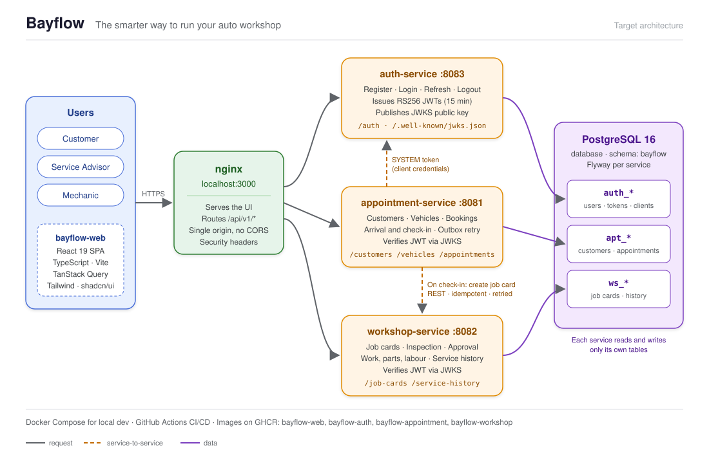

# Ramplight

**The smarter way to run your auto workshop.**

> **Name:** the product is called **Ramplight** (public site: `getramplight.com`). Inside the
> code it keeps its codename **Bayflow**: Java packages (`com.bayflow`), the database schema,
> `BAYFLOW_*` settings, `X-Bayflow-*` headers and image names. The visible name lives in
> `frontend/src/lib/brand.ts`.

Ramplight is a vehicle maintenance platform that runs a workshop from booking to
service history: customers book appointments, service advisors check vehicles
in and manage job cards, mechanics log the work, and every completed job is
recorded in the vehicle's service history.

> **Status:** all 8 milestones complete. See [docs/PLAN.md](docs/PLAN.md) for the
> design, the workflows and the assumptions.

## Architecture



- **nginx** serves the React app and routes each `/api/v1/*` path to the right
  service, so the browser talks to a single origin.
- **auth-service** issues JWTs; the other services verify them with its public
  key (JWKS).
- **appointment-service** creates the job card in **workshop-service** at
  check-in, using a SYSTEM token. The call is idempotent and retried from an
  outbox if workshop-service is down.
- **notification-service** stores each user's in-app notifications. The other
  two services send it events (booking changes, check-in, estimate, decision,
  finished work) through their outboxes, so none are lost while it is down; it
  asks auth-service who works at the location.
- All services share one PostgreSQL schema, but each reads and writes **only
  its own tables** (`auth_*`, `apt_*`, `ws_*`, `ntf_*`).

| Component | Tech |
|---|---|
| Backend | Java 21, Spring Boot 4.1, Spring Security (JWT), Spring Data JPA, Flyway |
| Database | PostgreSQL 16, one schema, table prefix per service (`auth_`, `apt_`, `ws_`, `ntf_`) |
| Frontend | React 19, TypeScript, Vite, TanStack Query, Tailwind CSS + shadcn/ui |
| Tests | JUnit 5, AssertJ, Testcontainers, WireMock, Vitest, Playwright |
| Delivery | Docker Compose, GitHub Actions, GitHub Container Registry |

## Prerequisites

- JDK 21 (Temurin recommended)
- Maven 3.9+
- Docker Desktop (for Postgres, Testcontainers and the full stack)
- Node 22.12+ (24 LTS recommended) and pnpm 10.26 or later (CI and the image use 10; 11 and 12 work too): `npm install -g pnpm@10`
  (Node 25+ no longer includes Corepack, so `corepack enable` does not work there)

## Quick start

```bash
# Optional: copy the environment template and adjust ports or secrets
cp .env.example .env                 # PowerShell: Copy-Item .env.example .env

# Build and start everything: PostgreSQL, the four services and the web app
docker compose up -d --build
docker compose ps                    # all five should become "healthy"
```

Open **http://demo.localhost:3000** and sign in with a demo user below. Every workshop
has its own address, `<workshop>.localhost:3000`; the dev profile seeds two, **demo** and
**acme**. **http://localhost:3000** itself is the public site where new workshops sign up.
Chrome, Edge and Firefox resolve `*.localhost` to your own machine, so no hosts-file edits.

> **Upgrading an existing local database** (created before SaaS phase 2): the
> services now connect as a separate `bayflow_app` login so that row-level
> security applies to them. Create it once, keeping your data:
> `./scripts/upgrade-local-db.ps1` (or `.sh`), then `docker compose up -d --build`.
> Or start from an empty database with `docker compose down -v` (deletes local data).

| What | URL |
|---|---|
| **Workshop "demo"** (all data from before SaaS phase 4) | http://demo.localhost:3000 |
| **Workshop "acme"** (second demo workshop) | http://acme.localhost:3000 |
| **Public site** (landing page, demo requests, sign-up by setup link) | http://localhost:3000 |
| **Ramplight console** (dev: `console1` / `Bayflow!2026`) | http://localhost:3000/console |
| Auth API docs (Swagger UI; signs in to "demo") | http://localhost:8083/swagger-ui.html |
| Appointment API docs (Swagger UI) | http://localhost:8081/swagger-ui.html |
| Workshop API docs (Swagger UI) | http://localhost:8082/swagger-ui.html |
| Notification API docs (Swagger UI) | http://localhost:8084/swagger-ui.html |
| Public signing key (JWKS) | http://localhost:8083/.well-known/jwks.json |

For frontend development with hot reload, keep the stack running and start the
Vite dev server instead (http://demo.localhost:5173, sign-up at http://localhost:5173):

```bash
cd frontend
pnpm install
pnpm dev
```

### Demo users (`dev` profile only)

The same four users exist in both demo workshops, **demo** and **acme**, as separate accounts:

| Username | Password | Role |
|---|---|---|
| `customer1` | `Bayflow!2026` | CUSTOMER |
| `advisor1` | `Bayflow!2026` | SERVICE_ADVISOR |
| `mechanic1` | `Bayflow!2026` | MECHANIC |
| `admin1` | `Bayflow!2026` | ADMIN |

Try it:

```bash
curl -i -X POST http://localhost:8083/api/v1/auth/login \
  -H "Content-Type: application/json" \
  -d '{"username":"advisor1","password":"Bayflow!2026"}'
```

### Set up a new workshop

Workshops join by invitation only.

1. In the console (http://localhost:3000/console, `console1` / `Bayflow!2026` in dev) open
   *Invitations* → **New invite** (or **Send setup invite** on a demo request). The setup link is
   e-mailed when e-mail is set up, and shown once to copy either way. It works once, for 7 days
   (`BAYFLOW_INVITE_TTL`); **Resend** replaces it, **Revoke** stops it.
2. Open the link (`http://localhost:3000/setup?invite=…`): name, address (checked live; taken
   and reserved addresses are refused), currency, time zone and your admin account. Without a
   working link the page explains how to get one.
   For internal testing, the console's *Workshops* → **Create test workshop** skips the invite.
3. You land on `http://<address>.localhost:3000/login`: sign in as that admin. The home page
   shows **Get your workshop ready** (logo, team, canned jobs, service intervals, other
   locations), ticked off as you go; it disappears once done or dismissed. Share the address
   with customers so they can register.

Nobody touches the database: the new workshop has its own users, settings and data, and a
session from one workshop is refused at any other workshop's address.

### One person, several roles

A person can do several jobs with one sign-in, e.g. a shop owner who is **Admin + Service advisor
+ Mechanic**. Roles combine: they see every page each role gives (the sidebar groups them into
*Front desk*, *Workshop*, *Insights* and *Admin*, each link once), and an admin who also advises
or fixes cars gets "Your work today" (Today's board, My jobs) on Home and the desk's and
mechanics' notifications at every location.

- *User accounts*: tick the roles when creating an account, and **Roles** changes them later
  (with locations when they work at chosen ones; an admin works everywhere). The workshop always
  keeps an admin, and nobody removes their own admin role.
- Sign-up asks the owner *Do you also work in the shop?*; an owner who is only an admin is asked
  once on Home.
- API: `POST /api/v1/auth/users` takes `roles` (or the older single `role`);
  `PUT /api/v1/auth/users/{id}/roles` (ADMIN; 409 `last-admin`, `cannot-remove-own-admin`);
  sign-up takes `ownerAlso` (`SERVICE_ADVISOR`, `MECHANIC`). Changes apply from the user's next
  token (within 15 minutes; your own at once). No migration: accounts already hold a set of roles.

### Team and customers' accounts

*Team* (`/users`, admins) lists **staff only** (`GET /api/v1/auth/users?kind=staff`). Customers'
online accounts are handled on each **customer's page**, in the *Online account* card: username,
sign-in email, status (Active / Locked / Disabled), **Reset password** and **Unlock** (advisors,
managers, admins), **Disable / Enable sign-in** (managers and admins; disabling signs them out
everywhere). The customer list shows each online account's status. API:
`/api/v1/auth/customer-accounts/{userId}` (GET, PATCH `{enabled}`, POST `/unlock`) and
`GET /api/v1/auth/customer-accounts?ids=…` (up to 100); customers' accounts only (404 for staff).

**Activity** (`/activity`, admins) is the workshop's audit trail: staff created, roles and
locations changed, accounts enabled, disabled or unlocked, passwords reset and photos removed,
with who did it and when (`GET /api/v1/auth/audit-events?userId=…`). Each event is written in
the same transaction as the change; the services may add events but never edit or delete them
(`auth_audit_events` has no UPDATE or DELETE grant).

### Avatars (My profile)

Everyone signed in has **My profile** (user menu, top right) and chooses how they show: their
**initials** (the default, in a colour of their own), one of 12 built-in **characters** (they move
gently on the profile page), or their own **photo** (JPEG, PNG or WebP; the page sends the middle
square, the server re-checks it, cuts it square, keeps 256 px JPEG and drops metadata such as
location). The avatar shows in the header and in *User accounts*, where an admin can **Remove
photo** (back to initials) but never upload for someone. API: `PUT /api/v1/auth/me/avatar`,
`PUT /api/v1/auth/me/avatar/photo` (multipart), `DELETE /api/v1/auth/users/{id}/avatar` (ADMIN);
photos are served at `/api/v1/tenants/current/avatars/{userId}?v=…` (the version makes the address
unguessable and cacheable for good). Migration: auth V21.

### Brand your workshop

Sign in as the workshop's admin → *Workshop settings* → **Branding**:

- **Logo** (PNG or JPEG, up to 1 MB) replaces the Ramplight logo in the header, on the sign-in
  page and as the browser tab's icon.
- **Sign-in cover photo** (PNG or JPEG, up to 3 MB) shows beside the sign-in form.
- **Colour** becomes the app's main colour (buttons, links, highlights) in the light and dark
  theme; text on it turns white or black automatically, and a warning shows for colours that
  are hard to read.
- **Announcements** (up to 10): each one line of plain text (holiday hours, an offer),
  Information or Important, optionally only between two dates. Every page shows the live ones
  as **one line**, the important one first, with **"N more"** to open the rest: full size for
  customers and the sign-in page, slim for staff. The list shows which are live, scheduled or
  ended.
- **"Powered by Ramplight"** at the bottom of the pages can be turned off.

Images are checked by their content (not their name), re-encoded and scaled down on the
server, which also removes metadata such as a photo's GPS location. Everything applies at
once at the workshop's address, for everyone, signed in or not.

### Notifications

Everyone signed in has a **bell** in the header. It shows how many notifications are unread
(checked every 30 seconds and when you come back to the tab); clicking it lists them, and
clicking one opens the booking or job card. **Reading a notification deletes it**: Bayflow keeps
only unread ones (and deletes unread ones after 90 days). *Mark all read* deletes them all. The
Notifications page (`/notifications`) lists the same, page by page.

| When | Who is told |
|---|---|
| A customer books, moves or cancels | The location's advisors and managers |
| The workshop books, confirms, moves or cancels | The customer |
| The car is checked in | The customer, and the location's mechanics |
| The estimate is sent | The customer |
| The customer decides | The location's advisors and managers, and its mechanics if work was approved |
| The work is complete | The customer |

Nobody is told about their own action, and staff only hear about the locations they work at.

### Dashboard and reports

Owners (**admin**) and location **managers** start on the **Dashboard**: sales, car count,
average repair order, close ratio, hours billed and effective labour rate for the period
(this month by default) against the period before, what is in the shop now, sales by day,
technicians and locations. It refreshes every minute. Managers see their own locations; the
location switcher narrows to one.

**Reports** has a tab per report, each for any period up to 366 days and exportable as CSV:
Summary, Sales details, Payments (per method, for the till), Unpaid invoices (by age), Tax (per
category and rate), Service advisors, Technicians, Declined jobs (a follow-up list) and Parts
usage. Periods follow the workshop's time zone. Sales are before tax: an issued invoice counts on
its issue date, a completed job without one on its completion date. The dashboard also shows what
was collected in the period and what customers still owe.

### Invoices

When a job is completed, the advisor opens the job card and clicks **Create invoice**. The
draft has the job's parts and labour, the location's shop supplies and disposal fees, and its tax
rates (set by the admin under *Locations → Tax & fees*). Adjust prices, enter what parts cost
(for profit; customers never see it), add a fee or discount, then **Issue invoice**: it gets the
next number (`INV-1001`, …) and the customer sees it under *Invoices*. **Record payment** for cash,
card, check or transfer; managers and admins can refund or void. *Print / Save as PDF* gives a
clean printable invoice.

**Email invoice** sends the whole invoice in the email body (with a *View online* link when the
customer has an account); replies go to the location's address. Locally it lands in Mailpit
(http://localhost:8025). Managers and admins can **Export** a period from the Invoices page: an
invoices CSV in QuickBooks Online's import layout and a payments CSV.

### Public site and demo requests

getramplight.com (the base domain) shows the product, **Set up your workshop**, the sign-in
shortcut to a workshop's address, and **Request a demo** (name, email, phone, shop or group name,
shop type, number of locations). Requests are stored in `auth_demo_requests` and e-mailed to
`BAYFLOW_DEMO_NOTIFY_EMAIL` when it is set (locally: Mailpit); nothing is sent to the address typed
in, and each IP may send 5 an hour. Someone who asks again while their request is still open
(New, Contacted, Demo scheduled) doesn't get a second row: the new details go into that
request's notes, it moves back to the top marked **Asked again**, and the team gets an "asked
again" e-mail. The form answers the same either way, so it never reveals whether an address
asked before.

### Ramplight console

`<base domain>/console` (locally http://localhost:3000/console) is for Ramplight's own team. Its
accounts have the `PLATFORM_ADMIN` role and live in a separate organization (`ramplight-console`)
that no workshop address can reach; the browser asks for it with the `X-Bayflow-Client: console`
header, so a workshop account cannot sign in there and a console account cannot sign in at a
workshop. A console account is created at start-up from `BAYFLOW_PLATFORM_ADMIN_USERNAME`
/ `_EMAIL` / `_PASSWORD` when the password is set and that username doesn't exist yet; change the
password after the first sign-in (the dev profile also seeds `console1`). **Demo requests** lists
what came in from the public site, with a status (New, Contacted, Demo scheduled, Demo done,
Declined) and private notes; **Send setup invite** there marks it Invited, and it becomes
Onboarded when the owner uses the link. **Invitations** lists every setup link (Pending, Expired,
Set up, Revoked) with Resend and Revoke; an unused link gets one reminder e-mail 2 days before it
expires (`BAYFLOW_INVITE_REMINDER_BEFORE`) and shows **Expiring soon**. Only a hash of each link is
stored (`auth_invitations`). **Workshops** lists every workshop with its owner, staff, customers
and locations: **Suspend** stops every sign-in there (data kept) until **Reactivate**, and
**Create test workshop** makes one for internal testing without an invite, labelled **Test**.
APIs: `/api/v1/auth/platform/**`.

### Online booking (services and links)

Admins keep the services customers can book under *Settings → Online booking*: name, a short
description, the price customers see (**from $54**, **$79**, **Free**, **Ask for a quote**, or
none), the typical time, and for groups which location offers it; hide, show and reorder them.
A new shop starts with oil change, routine service, brakes, tires, inspection and diagnostic,
without prices. "Something else" is always offered. Each active location has a **Copy booking
link** under *Locations* (`<address>/book?location=<code>`) for its Google Business Profile and
website. API: `/api/v1/booking-services` (appointment-service).

**Booking hours** (same section, per location): weekly open and close times, slot length
(15 min to 2 h), cars per slot, notice needed (default 2 hours) and how far ahead customers may
book (default 30 days). A slot is offered while fewer than *cars per slot* bookings start in it.

**The booking page** (`<address>/book`, no account needed): service → car (year, make and model,
or the VIN) → time → first name, last name, email and optional phone. With a phone the customer
can tick *text me about this visit*; the page says the number is never shared with or sold to
third parties. `?location=<code>` preselects the location (groups otherwise pick from a list;
one-location shops are never asked) and `?service=<code>` the service. The booking is confirmed
at once and e-mailed; staff see it with an **Online** badge and are notified as usual. The
customer is matched by e-mail (or added without a login) and the car by VIN or year/make/model.
A car booked without VIN or plate gets them at check-in (the job card needs both). Bookings are
limited to 10 an hour per address. Public API: `/api/v1/booking/options`, `/availability`,
`/appointments` (send `X-Bayflow-Client`).

**Change or cancel** (`<address>/book/manage?token=…`): every e-mail about an online booking
carries a private link (only the token's SHA-256 is stored). The customer can move the booking
to another free time (up to 3 times) or cancel it with an optional reason, until the location's
notice before the visit; after that, or once the car has arrived, the page says to call the
shop. The desk is notified of every customer change, and the appointments list shows "By the
customer: <reason>" or "Moved by the customer". When staff move or cancel an online booking the
customer is e-mailed; a moved booking gets a new link (the old one stops working). Links use
`BAYFLOW_SITE_URL`. Public API: `POST /api/v1/booking/manage`, `/manage/reschedule`,
`/manage/cancel` (token in the body).

**Accounts**: the confirmation and manage pages offer *Create an account* / *sign in*. Once the
customer is signed in, the booking is claimed with its token (`POST /api/v1/customers/me/claim`):
with no profile yet, the online booker's record becomes theirs; otherwise its cars and bookings
move to their profile. The page never tells anyone whether an e-mail has an account or a VIN is on file: an account's
e-mail booked without signing in goes to a separate guest record (the confirmation goes to that
address, whose owner can cancel it or add it to their account), and a VIN already on another
customer's car is booked on a placeholder car reading "VIN …", with a note for the desk.

### Estimate approval by link

*Send to customer for approval* also e-mails the customer a private link (when they have an
address). On `/estimate?token=…`, with no account, they see the findings and each recommended item
with its price, approve or decline each one, type their name and sign; the job card moves on as
if they had answered in the app, and the advisor and mechanics get *Estimate decided*. Two
reminders go out a day apart while nothing is decided (a cross-instance job, 15-minute runs); the
link works 14 days (`bayflow.workshop.estimates.*`). On the job card, advisors see *Customer
approval link*: sent to, opened, reminders, then who signed and the signature; *Send again* (or
to another address) replaces the link. Only the token's hash is stored, so each reminder carries
a new link; earlier ones keep working until a new one is sent. API:
`/api/v1/job-cards/{id}/estimate-link` (GET, POST, `/signature`) and the public
`POST /api/v1/estimate-approval/view|decide`.

### Quick estimates and VIN decode

For a customer on the phone or at the desk, advisors, managers and admins click **New estimate** on *Job
cards* or a customer's page: pick the customer and car, and type what they asked for. The visit is
made with status `ESTIMATE` (no time; not on the board or the day's list, and it holds no slot), and
its job card opens at once with the request as the first finding. Price it and send the approval
link as usual. **Schedule the work** books the visit (`ESTIMATE → BOOKED`); at check-in the same
card carries on, marked arrived with the new odometer reading. Work can't start or complete before
that. **Close estimate** declines what is pending and cancels the visit. *Job cards → Show →
Estimates* lists the open ones with their age; nothing closes them automatically. API:
`POST /api/v1/appointments/estimates`, `POST /api/v1/appointments/{id}/schedule`,
`POST /api/v1/job-cards/{id}/close-estimate`, `GET /api/v1/job-cards?estimates=true`.

When staff add a car, its VIN is looked up once all 17 characters are typed (NHTSA vPIC, free, no
key): year, make, model, trim and engine fill in where empty (**Use decoded details** replaces what
was typed), with a warning when the check digit doesn't add up. Check-in does the same for cars
booked online without a VIN. `GET /api/v1/vehicles/decode?vin=` (staff; 120 lookups an hour per
user, a 3 s timeout, results cached in memory; `bayflow.integration.vin-decoder.*`,
`BAYFLOW_VIN_DECODER_URL`). If vPIC is down, details are typed by hand as before.

On the public booking page, a customer who books by VIN sees which car it is ("Your car: 2018
Toyota Corolla"), and the year, make and model are saved with the booking
(`GET /api/v1/booking/vin`, 20 lookups an hour per address and workshop, `public-max-per-hour`).

**Scan VIN** (beside the VIN field when adding a car and at check-in) reads the VIN barcode on the
door frame or windscreen with the phone's camera. It uses the browser's own barcode reader, so it
appears in Chrome and Edge on Android; on iPhone and desktop browsers without one, the VIN is typed.
The site allows its own pages to use the camera (`Permissions-Policy: camera=(self)`).

Managers work estimates like advisors: a manager is also a service advisor at their locations (the
token converter adds the role), so everything above is open to them there.

### Canned jobs

Managers and admins keep the shop's everyday work under *Canned jobs* (e.g. "Synthetic oil
change": description, labour hours and usual parts; for every location or one). On a job card
the advisor picks **From canned job** to fill in a recommendation, and once it's approved the
mechanic clicks **Add usual parts & labour** to record them in one go (labour at the card's rate).

### Maintenance due (service intervals)

Each workshop starts with common intervals (oil change every 5,000 mi or 6 months, tire rotation,
brake inspection, cabin filter, coolant) that admins change under *Workshop settings → Service
intervals*. A completed job whose approved work matches one (by canned job or keyword) records it;
the vehicle is due again after the miles or the months, whichever comes first, using its own miles
a day when it has visited before. Advisors see **Due soon**, and at check-in the job card offers
**Also due on this vehicle** as one-click recommendations.

Once a day (14:00 UTC) customers with an account get an in-app reminder ("BFL 1234 is due for Oil
change, Tire rotation", linking to *Book a service*) the shop's *Remind days before* ahead of each
due date, once per due date. Advisors can **Send reminder** from *Due soon*; customers turn reminders
off on their *Notifications* page; admins switch them off under *Service intervals*.

### QuickBooks Online

An admin connects the company under *Settings → QuickBooks Online* and chooses the QuickBooks
products/services for parts, labour and fees (and optionally the account payments go to). Then
**Send to QuickBooks** on an issued invoice creates the customer (if new) and the invoice, with
Ramplight's number and tax total, then its payments; sending again sends only new payments, and a
voided invoice is voided there too. Refunds are entered in QuickBooks by hand. US companies, in
their home currency.

To try it, create an app at https://developer.intuit.com (it comes with a sandbox company), add
the redirect URI `http://localhost:3000/api/v1/quickbooks/callback`, and set in `.env`:
`BAYFLOW_QBO_CLIENT_ID`, `BAYFLOW_QBO_CLIENT_SECRET` and `BAYFLOW_QBO_TOKEN_KEY`
(`openssl rand -base64 32`). On the server the redirect URI is
`https://<domain>/api/v1/quickbooks/callback` (one for every workshop).

### Try the whole workflow in the web app

At http://demo.localhost:3000 (or the dev server on :5173):

1. **customer1** — complete the profile on first sign-in, add a vehicle under
   *My vehicles*, then *Book a service*.
2. **advisor1** — on *Today's board* (pick the booking's day): *Confirm* →
   *Mark arrived* → *Check in* with the odometer reading. The job card opens
   automatically.
3. **mechanic1** — *My jobs* → the card under *Needs inspection* → add findings.
4. **advisor1** — on the job card: add recommended work with estimates, then
   *Send to customer for approval*.
5. **customer1** — *Job cards* → approve or decline each item (or, from the e-mailed link,
   approve, decline and sign without signing in; see *Estimate approval by link*).
6. **mechanic1** — *Start work*, log work (plus parts and labour) for each
   approved item, then *Complete job*.
7. **customer1** — *My vehicles* → the vehicle → its service history.
8. **admin1** — the *Dashboard* shows the completed job in today's numbers; *Reports* for
   the details. *User accounts* to create staff; *Workshop settings* for the workshop's
   name, labour rate, currency and time zone; read-only views elsewhere.

### Using the APIs directly

Each service has Swagger UI (links above). Get a token from
`POST /api/v1/auth/login` in the auth Swagger UI, click **Authorize** in the other
service's Swagger UI and paste it.

## How authentication works

- **auth-service** stores users (BCrypt passwords) and signs **access tokens**:
  RS256 JWTs valid for 15 minutes with claims `sub` (user id), `username`,
  `roles`, `tid` (the user's workshop), `iss=bayflow-auth`, `aud=bayflow`.
- **Workshops (multi-tenancy):** every row belongs to a workshop (`tenant_id`),
  and every service scopes all queries to the workshop in the caller's token.
  Details: [docs/PLAN.md § 9, items 17–20](docs/PLAN.md#9-assumptions); moving to AWS:
  [docs/SAAS-AWS-NOTES.md](docs/SAAS-AWS-NOTES.md).
- **Row-level security:** PostgreSQL itself hides other workshops' rows. The
  services connect as `bayflow_app` (not the table owner, so the policies apply
  to it) and name their workshop per transaction; Flyway migrates as the owner.
  A service refuses to start with a login that RLS would not apply to.
- **Workshop addresses:** a workshop is at `<slug>.<BAYFLOW_BASE_DOMAIN>`
  (`demo.localhost`). Sign-in, registration and refresh find the workshop from that address
  (nginx passes it in `X-Forwarded-Host`); after that it comes only from the token, which also
  names the address (`tsl`). Every service refuses a token at another workshop's address (401).
  Unknown addresses show *Workshop not found*; a suspended workshop can't sign in.
- **Locations:** a workshop (organization) has one or more locations (shops). Every
  organization starts with "Main"; appointments, job cards and history belong to a
  location, and a location may override the organization's time zone and labour rate.
  Staff (MANAGER, SERVICE_ADVISOR, MECHANIC) see only the locations they work at,
  enforced by the services and by row-level security; ADMIN sees all of them.
  Admins manage locations under *Locations* and assign staff under *User accounts*;
  staff with several locations get a switcher in the header; customers choose a
  location when booking. Organizations with one location see none of this.
  Details: PLAN items 21–23 and `docs/prompts/organizations-locations.md`.
- **Workshop settings:** each workshop's labour rate, currency and time zone
  live in auth-service and are edited by its ADMIN. The other services read
  them with SYSTEM tokens. A job card keeps the rate and currency it opened
  with; the web app shows times in the workshop's zone. The `BAYFLOW_LABOUR_RATE`,
  `BAYFLOW_CURRENCY` and `BAYFLOW_WORKSHOP_ZONE` variables are now only defaults
  for new workshops (details: PLAN item 19).
- The **refresh token** is a random value sent only as the `bayflow_rt` cookie
  (`HttpOnly`, `SameSite=Strict`, path `/api/v1/auth`), valid 7 days. Only its
  hash is stored. Every `/auth/refresh` rotates it; replaying an old one ends
  the whole session.
- **CSRF:** the services are bearer-token APIs (no sessions, no auth cookies), so
  Spring's CSRF filter is off. The two cookie endpoints, `/auth/refresh` and
  `/auth/logout`, instead require the `X-Bayflow-Client` header (which a cross-site
  page cannot send without a CORS preflight, and Bayflow allows none) and refuse
  `Sec-Fetch-Site: cross-site`. The web app sends the header on every call.
- Other services verify tokens with the public key from
  `/.well-known/jwks.json` (shared setup in `backend/common-security`).
- **appointment-service** gets a short-lived `SYSTEM` token from
  `POST /api/v1/auth/token` (client credentials) to call workshop-service.
- **Roles:** CUSTOMER (self-registered), SERVICE_ADVISOR, MECHANIC and ADMIN.
  Only an ADMIN creates or disables staff accounts (`/api/v1/auth/users`).
  The first admin outside dev is created from `BAYFLOW_BOOTSTRAP_ADMIN_*` in
  `.env` when no admin exists yet.
- Login is protected by a rate limit (10 attempts/minute per username + IP)
  and a 15-minute lock after 5 wrong passwords.
- **Forgot password? by e-mail:** when e-mail is set up (`BAYFLOW_MAIL_*`; locally every
  e-mail lands in Mailpit at http://localhost:8025), the sign-in page offers *Reset it by email*.
  The link (`/reset-password?token=…` at the workshop's own address) works once, for 60 minutes;
  only its hash is stored, the answer never says whether an address has an account, and
  addresses get at most 3 e-mails an hour. Using it unlocks the account, signs it out everywhere
  and signs in; a "password changed" e-mail follows. E-mails go through an outbox
  (`auth_mail_outbox`) and are retried; their bodies are cleared once sent. Any SMTP server works:
  Gmail for demos, SES or SendGrid later, by settings only (`docs/GCP-DEPLOY.md`, *E-mail*).
- **Signing in and forgotten passwords:** people sign in with their username or their
  e-mail address. Someone who forgot their password can also ask the workshop: an ADMIN can reset
  anyone else's password (*User accounts → Reset password*), and advisors and managers a
  customer's (the customer's page). The reset shows a temporary password once
  (`POST /api/v1/auth/users/{id}/password-reset`); it unlocks the account, signs it out
  everywhere, works for 72 hours (`bayflow.auth.temporary-password-ttl`) and must be replaced
  at the next sign-in. Anyone can change their own password from the account menu
  (`POST /api/v1/auth/me/password`, which signs out their other devices).
- Signing key: without configuration, auth-service generates a throwaway key at
  startup (tokens stop working after a restart). For a stable key run
  `scripts/generate-dev-keys.sh` (or `.ps1`) and set the two
  `BAYFLOW_JWT_*_KEY_PATH` lines in `.env`. In production set
  `BAYFLOW_JWT_ALLOW_EPHEMERAL=false` and mount real keys.

## Tests

| Command | What it covers |
|---|---|
| `mvn -f backend/pom.xml verify` | Unit tests (state machines, rules), Testcontainers integration tests for every service against PostgreSQL 16, WireMock tests of the check-in → job card integration, the shared-schema migration test, JaCoCo ≥ 80% on domain and application code. Needs Docker running. |
| `pnpm test` (in `frontend/`) | Vitest + Testing Library + MSW: sign-in flow, forms, role-based screens. |
| `pnpm e2e` (in `frontend/`) | 23 recorded Playwright scenarios against the running stack (`docker compose up -d --build`): the full journey plus edge cases (lockout, roles, data isolation, double booking, concurrent advisors, odometer rules, partial/declined approval, work rules, workshop outage). Every actor is filmed; open `frontend/e2e-videos/index.html` to watch them side by side. First time: `pnpm e2e:install`. See *End-to-end scenarios* below. |

## End-to-end scenarios

```bash
docker compose up -d --build --wait     # the stack: demo.localhost:3000, acme.localhost:3000
cd frontend
pnpm e2e:install                        # once: Playwright's Chromium
pnpm e2e                                # every scenario in both workshops, desktop + phone
E2E_WORKSHOPS=demo pnpm e2e             # one workshop only (about half the time)
pnpm e2e --project=desktop-demo -g "double booking"   # one scenario
```

Afterwards open **`frontend/e2e-videos/index.html`**: pick a scenario and every person in it
(customer, advisor, mechanic, admin) plays side by side, in sync. A caption on each screen
says who they are and what is being tried; amber captions are edge cases, green ones are
checks. The timeline under the videos jumps to any step. `playwright-report/` has the same
videos plus a trace for any failure.

| File | Scenarios |
|---|---|
| `01-happy-path` | Sign-up → booking → check-in → inspection → partial approval → work, parts, labour → service history |
| `02-accounts-and-access` | Sign-up validation and duplicates; lockout after 5 wrong passwords; deep link and sign-out; what each role may open (UI and API); one customer can't see another's job card or car; disabling a user revokes their session |
| `03-booking` | Profile required first; VIN format and uniqueness; double booking (overlap, wrap-around, back-to-back allowed, past time); reschedule into a clash; cancelled slot can be rebooked; advisor books for a walk-in |
| `04-check-in` | Two advisors on the same booking (409 on the stale screen); odometer validation and "never backwards"; no-show only after the start time; no check-in before arrival; no second check-in |
| `05-job-card` | Decline everything → inspection only; no work needed; customer and advisor decide the same item at once; only approved items can be worked on; every approved item needs work before completing; completed cards are locked; who can do what |
| `06-resilience` | Stops `workshop-service`, checks in, starts it again: the job card arrives from the outbox, exactly once. Needs the Docker CLI; skip with `E2E_SKIP_CHAOS=1` |
| `07-workshops` | Two workshops sign up through the public site, configure themselves, and reuse the same admin username independently; taken and reserved addresses refused; a token from one workshop refused at the other's address (401); an unknown address shows *Workshop not found* |
| `08-locations` | The owner adds a location in Auckland with its own rate, hires an advisor for it; a customer books there in Auckland time; each location's advisor sees only their own; the job card charges the location's rate; the switcher shows one location or all; the location is archived again at the end |
| `09-branding` | A new workshop's owner uploads a logo and cover photo (a fake PNG is refused), sets a colour and an announcement and turns off "Powered by Ramplight"; a customer sees all of it on the sign-in page and in the app; the images are served cached; other workshops are unchanged; removing the logo brings Ramplight's back |
| `10-notifications` | A customer books and the advisor's bell shows it; confirmation and check-in reach the customer, the check-in the mechanic; the estimate reaches the customer, who opens the job card from it; the decision reaches the advisor and mechanic; "ready to collect" reaches the customer; another customer hears nothing |

Pace of the videos: `E2E_SLOWMO` (ms per action, default 250) and `E2E_STEP_PAUSE` (ms per
caption, default 900); set both to `0` for a fast run. The scenarios create their own
customers, so they can run again and again against the same database; staff logins are
spaced out to stay under the 10-per-minute login limit.

## CI/CD

- **CI** (`.github/workflows/ci.yml`, every push and pull request):
  - *backend*: `mvn verify`, uploads test and coverage reports
  - *frontend*: `pnpm audit` (production dependencies, fails on HIGH/CRITICAL), lint, type-check,
    unit tests, build
  - *dependencies*: Trivy scans the Maven and pnpm manifests (fails on a fixable HIGH/CRITICAL)
  - *compose*: validates `docker-compose.yml`
  - *e2e* also checks that `frontend/src/api/schema` matches the running services' OpenAPI
    documents: after a backend API change, run `pnpm api:update` (stack up) and commit it
  - *e2e* (after backend and frontend pass): `docker compose up --build --wait`, runs
    Playwright, uploads the report and the scenario videos, prints service logs on failure
- **CD** (`.github/workflows/cd.yml`, after CI succeeds on `main`): builds each image, scans it
  with Trivy (a fixable HIGH/CRITICAL stops it), then pushes `ghcr.io/<owner>/bayflow-auth`,
  `bayflow-appointment`, `bayflow-workshop`, `bayflow-notification` and `bayflow-web`, tagged with
  the commit SHA and `latest`, with an SBOM and build provenance attached.
- **Dependabot** keeps Maven, npm, Docker and GitHub Actions dependencies current.
  PostgreSQL, Java and Node major versions are upgraded deliberately, not by bot.

## Outboxes: retries and giving up

appointment-service and workshop-service send job cards, notification events and online-booking
e-mails through outboxes (`apt_outbox`, `ws_outbox`): saved with the change, sent right after it
commits (never while it holds a lock), retried with backoff. After `max-attempts` failures (50,
about 4 hours; `bayflow.integration.dispatcher.max-attempts`,
`bayflow.workshop.notifications.max-attempts`) a message is given up: `failed_at` is set and
an ERROR "Gave up on outbox message …" is logged. To retry one by hand:
`UPDATE apt_outbox SET failed_at = NULL, attempts = 0, next_attempt_at = now() WHERE id = '…'`.
A sent e-mail's content is cleared from the outbox (it holds the private booking link).
The outboxes are in the metrics (`bayflow_outbox_pending`, `bayflow_outbox_failed`,
`bayflow_outbox_oldest_pending_seconds`) with alerts; see [docs/OBSERVABILITY.md](docs/OBSERVABILITY.md).

## Several instances of a service

Every service can run as two or more instances behind a load balancer:

- **Scheduled jobs** (outbox dispatchers, reminders, retention, invite reminders) run on one
  instance at a time, through a lock row in PostgreSQL (`<prefix>_job_locks`, `JobLock`). A lock
  lasts at most a set time, so a crashed instance can't block a job; daily jobs keep theirs a few
  minutes so an instance with a slightly late clock doesn't run them twice.
- **Rate limits** (logins, sign-ups, password-reset e-mails, online bookings) are counted in
  PostgreSQL (`auth_rate_limits`, `apt_rate_limits`) in fixed windows, so the limits hold across
  instances. Keys are stored hashed (no e-mail addresses or IPs).
- Sessions are tokens and the outboxes are in the database, so nothing else is per instance.

## Running outside local development

**On Google Cloud:** follow [docs/GCP-DEPLOY.md](docs/GCP-DEPLOY.md) (one VM, Docker Compose,
Caddy with a wildcard certificate, nightly backups). It applies everything below.

- Set `SPRING_PROFILES_ACTIVE` to something other than `dev` (no demo users), set
  `BAYFLOW_BOOTSTRAP_ADMIN_PASSWORD` for the first admin, and change
  `BAYFLOW_SYSTEM_CLIENT_SECRET`, `BAYFLOW_WORKSHOP_CLIENT_SECRET` and the database password.
- Set `BAYFLOW_BASE_DOMAIN` to your domain (wildcard DNS and certificate for `*.<domain>`),
  leave `BAYFLOW_FALLBACK_WORKSHOP` empty, and see [docs/SAAS-AWS-NOTES.md](docs/SAAS-AWS-NOTES.md).
- Generate a real signing key (`scripts/generate-dev-keys.*` shows how), mount it,
  and set `BAYFLOW_JWT_ALLOW_EPHEMERAL=false`.
- Serve the web app over HTTPS (e.g. a load balancer in front of `bayflow-web`) and set
  `BAYFLOW_COOKIE_SECURE=true` so the refresh cookie is only sent over HTTPS.
- Turn Swagger UI off if the APIs should not be browsable (`SPRINGDOC_SWAGGER_UI_ENABLED=false`).
- Under the `prod` profile, auth-service refuses to start with a built-in development client
  secret (`dev-…`).
- Logs, metrics, tracing and alerts: [docs/OBSERVABILITY.md](docs/OBSERVABILITY.md).

## Repository layout

| Path | Contents |
|---|---|
| `backend/` | Maven multi-module build (`bayflow-parent`) |
| `frontend/` | bayflow-web React app ([frontend/README.md](frontend/README.md)) |
| `infra/postgres/init/` | creates schema `bayflow` on first start |
| `infra/nginx/` | nginx config for the web image: routing, caching, security headers |
| `scripts/` | helper scripts (dev JWT key generation) |
| `deploy/gcp/` | production on one Google Cloud VM: Compose file, Caddy (HTTPS), setup and backup scripts ([docs/GCP-DEPLOY.md](docs/GCP-DEPLOY.md)) |
| `docs/` | build plan and design notes |
| `.github/` | CI/CD workflows and Dependabot |

## Milestones

| # | Scope | Status |
|---|---|---|
| 1 | Monorepo skeleton, compose (Postgres), CI skeleton | ✅ done |
| 2 | common-security + auth-service | ✅ done |
| 3 | appointment-service | ✅ done |
| 4 | workshop-service: job card, inspection, approval | ✅ done |
| 5 | Work logging, completion, history + check-in integration | ✅ done |
| 6 | Frontend foundation | ✅ done |
| 7 | Frontend screens per role | ✅ done |
| 8 | nginx, full compose, Playwright e2e, CD | ✅ done |
| SaaS 1 | Tenant foundation (`tenant_id`, `tid` claim) | ✅ done |
| SaaS 2 | Row-level security and isolation tests | ✅ done |
| SaaS 3 | Per-workshop settings, money frozen on job cards | ✅ done |
| SaaS 4 | Sign-up and workshop subdomains | ✅ done |
| Locations 1 | Organizations have locations ("Main" for everyone) | ✅ done |
| Locations 2 | Location-scoped roles and isolation | ✅ done |
| Locations 3 | Locations page, switcher, booking per location | ✅ done |
| Branding | Logo, colour, cover photo, announcement, "Powered by Ramplight" | ✅ done |
| Notifications 1 | In-app notifications: bell, panel, Notifications page | 🔍 in review |
| Reports 1 | Owner dashboard, reports with CSV export, who sent each estimate | 🔍 in review |
| Invoicing 1 | Invoices, tax and fees, payments, print; sales, payments, unpaid and tax reports | 🔍 in review |
| Invoicing 2 | Email invoices, CSV export for QuickBooks, QuickBooks Online connection | 🔍 in review |
| Faster counter 1 | Canned jobs | 🔍 in review |
| Faster counter 2 | Service intervals, Due soon, "Also due" at check-in, customer reminders | 🔍 in review |

## Assumptions

Documented in [docs/PLAN.md § 9](docs/PLAN.md#9-assumptions). The main ones:
one workshop time zone (default `America/New_York`), 60-minute default slots,
mileage in miles, a single currency (USD), and a separate ADMIN role that
manages user accounts.
