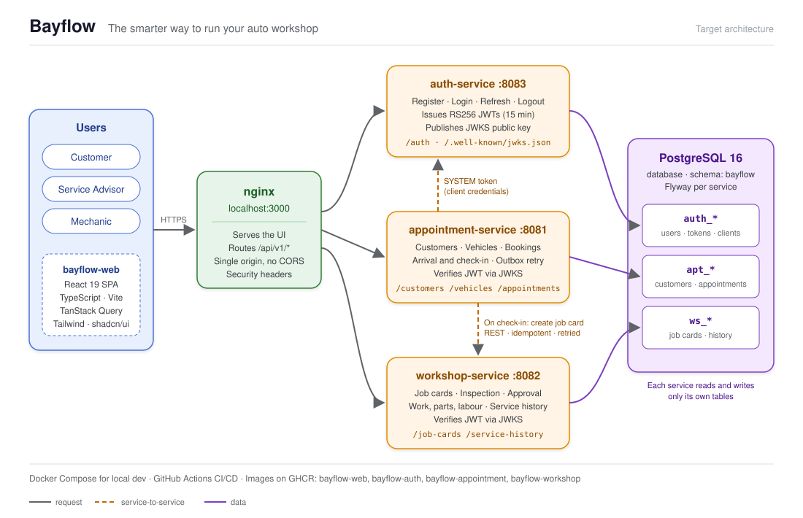

# Bayflow

**The smarter way to run your auto workshop.**

Bayflow is a vehicle maintenance platform that runs a workshop from booking to
service history: customers book appointments, service advisors check vehicles
in and manage job cards, mechanics log the work, and every completed job is
recorded in the vehicle's service history.

> **Status:** Milestone 5 of 8 — the backend workflow is complete. See
> [docs/PLAN.md](docs/PLAN.md) for the full design and the milestone list.

## Architecture (target)



- **nginx** serves the React app and routes each `/api/v1/*` path to the right
  service, so the browser talks to a single origin.
- **auth-service** issues JWTs; the other services verify them with its public
  key (JWKS).
- **appointment-service** creates the job card in **workshop-service** at
  check-in, using a SYSTEM token. The call is idempotent and retried from an
  outbox if workshop-service is down.
- All services share one PostgreSQL schema, but each reads and writes **only
  its own tables** (`auth_*`, `apt_*`, `ws_*`).

| Component | Tech |
|---|---|
| Backend | Java 21, Spring Boot 4.1, Spring Security (JWT), Spring Data JPA, Flyway |
| Database | PostgreSQL 16, one schema, table prefix per service (`auth_`, `apt_`, `ws_`) |
| Frontend | React 19, TypeScript, Vite, TanStack Query, Tailwind CSS + shadcn/ui |
| Tests | JUnit 5, AssertJ, Testcontainers, WireMock, Vitest, Playwright |
| Delivery | Docker Compose, GitHub Actions, GitHub Container Registry |

## Prerequisites

- JDK 21 (Temurin recommended)
- Maven 3.9+
- Docker Desktop (for Postgres, Testcontainers and the full stack)
- Node 22 LTS + pnpm (from milestone 6)

## Quick start

```bash
# 1. Optional: copy the environment template and adjust ports or secrets
cp .env.example .env                 # PowerShell: Copy-Item .env.example .env

# 2. Build and test the backend (needs Docker running for Testcontainers)
mvn -f backend/pom.xml verify

# 3. Start PostgreSQL and the three services
docker compose up -d --build
docker compose ps                    # all should become "healthy"
```

| What | URL |
|---|---|
| Auth API docs (Swagger UI) | http://localhost:8083/swagger-ui.html |
| Appointment API docs (Swagger UI) | http://localhost:8081/swagger-ui.html |
| Workshop API docs (Swagger UI) | http://localhost:8082/swagger-ui.html |
| Public signing key (JWKS) | http://localhost:8083/.well-known/jwks.json |
| Health | http://localhost:8083/actuator/health |

### Demo users (`dev` profile only)

| Username | Password | Role |
|---|---|---|
| `customer1` | `Bayflow!2026` | CUSTOMER |
| `advisor1` | `Bayflow!2026` | SERVICE_ADVISOR |
| `mechanic1` | `Bayflow!2026` | MECHANIC |
| `admin1` | `Bayflow!2026` | ADMIN |

Try it:

```bash
curl -i -X POST http://localhost:8083/api/v1/auth/login \
  -H "Content-Type: application/json" \
  -d '{"username":"advisor1","password":"Bayflow!2026"}'
```

### Try the appointment workflow

1. In the auth Swagger UI, log in as `customer1` and copy the `accessToken`.
2. In the appointment Swagger UI, click **Authorize** and paste it, then:
   `POST /customers/me` (your profile) → `POST /vehicles` → `POST /appointments`
   (a future `scheduledAt`, e.g. `2026-12-01T15:00:00Z`).
3. Log in as `advisor1`, authorize, and move the booking along:
   `confirm` → `arrive` → `check-in` (with the odometer reading).

Appointment statuses: BOOKED → CONFIRMED → ARRIVED → CHECKED_IN, or
CANCELLED / NO_SHOW; see the diagram in [docs/PLAN.md](docs/PLAN.md#4-state-machines).
Out-of-order steps return **409**, and a vehicle can't have two bookings that
overlap in time.

### Try the workshop: from check-in to service history

Checking a vehicle in (step 3 above) now opens its job card in workshop-service
automatically; the appointment shows the `jobCardId`. Then, in the workshop
Swagger UI:

1. As `mechanic1` or `advisor1`: `POST /job-cards/{id}/findings`.
2. As `advisor1`: `POST /job-cards/{id}/recommendations` (parts cost + labour
   hours; labour is priced at `BAYFLOW_LABOUR_RATE`), then `submit-for-approval`.
3. As `customer1`: `GET /job-cards/{id}` to see the estimates, then `approve` or
   `decline` each recommendation.
4. As `mechanic1`: `start`, then for each approved item log `work-logs`,
   `parts` and `labour`.
5. As `mechanic1` or `advisor1`: `complete`. Totals are calculated and the job
   is written to the vehicle's history: `GET /service-history/vehicles/{vehicleId}`
   (customers see their own vehicles' history).

If workshop-service is down at check-in, the check-in still succeeds; the job
card is created automatically when it is back (retried after 10 s, backing off
to every 5 minutes).

## How authentication works

- **auth-service** stores users (BCrypt passwords) and signs **access tokens**:
  RS256 JWTs valid for 15 minutes with claims `sub` (user id), `username`,
  `roles`, `iss=bayflow-auth`, `aud=bayflow`.
- The **refresh token** is a random value sent only as the `bayflow_rt` cookie
  (`HttpOnly`, `SameSite=Strict`, path `/api/v1/auth`), valid 7 days. Only its
  hash is stored. Every `/auth/refresh` rotates it; replaying an old one ends
  the whole session.
- Other services verify tokens with the public key from
  `/.well-known/jwks.json` (shared setup in `backend/common-security`).
- **appointment-service** gets a short-lived `SYSTEM` token from
  `POST /api/v1/auth/token` (client credentials) to call workshop-service.
- **Roles:** CUSTOMER (self-registered), SERVICE_ADVISOR, MECHANIC and ADMIN.
  Only an ADMIN creates or disables staff accounts (`/api/v1/auth/users`).
  The first admin outside dev is created from `BAYFLOW_BOOTSTRAP_ADMIN_*` in
  `.env` when no admin exists yet.
- Login is protected by a rate limit (10 attempts/minute per username + IP)
  and a 15-minute lock after 5 wrong passwords.
- Signing key: without configuration, auth-service generates a throwaway key at
  startup (tokens stop working after a restart). For a stable key run
  `scripts/generate-dev-keys.sh` (or `.ps1`) and set the two
  `BAYFLOW_JWT_*_KEY_PATH` lines in `.env`. In production set
  `BAYFLOW_JWT_ALLOW_EPHEMERAL=false` and mount real keys.

## Repository layout

| Path | Contents |
|---|---|
| `backend/` | Maven multi-module build (`bayflow-parent`) |
| `frontend/` | bayflow-web React app (milestone 6) |
| `infra/postgres/init/` | creates schema `bayflow` on first start |
| `infra/nginx/` | reverse proxy config (milestone 8) |
| `scripts/` | helper scripts (dev JWT key generation) |
| `docs/` | build plan and design notes |
| `.github/` | CI/CD workflows and Dependabot |

## Milestones

| # | Scope | Status |
|---|---|---|
| 1 | Monorepo skeleton, compose (Postgres), CI skeleton | ✅ done |
| 2 | common-security + auth-service | ✅ done |
| 3 | appointment-service | ✅ done |
| 4 | workshop-service: job card, inspection, approval | ✅ done |
| 5 | Work logging, completion, history + check-in integration | ✅ done |
| 6 | Frontend foundation | ⏳ next |
| 7 | Frontend screens per role | |
| 8 | nginx, full compose, Playwright e2e, CD | |

## Assumptions

Documented in [docs/PLAN.md § 9](docs/PLAN.md#9-assumptions). The main ones:
one workshop time zone (default `America/New_York`), 60-minute default slots,
mileage in miles, a single currency (USD), and a separate ADMIN role that
manages user accounts.
