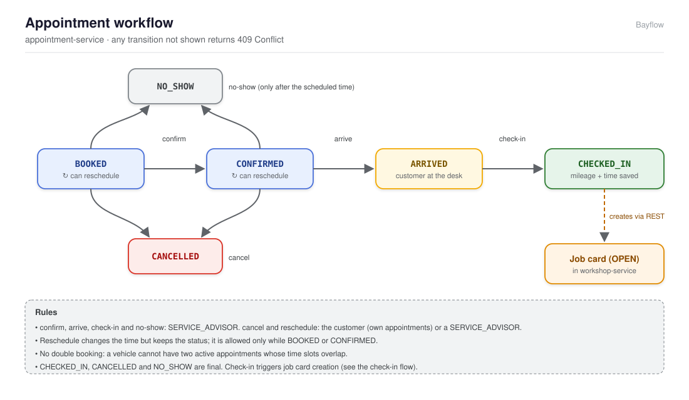
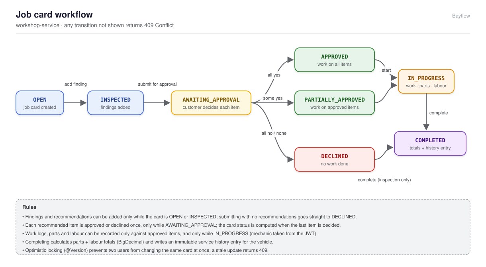
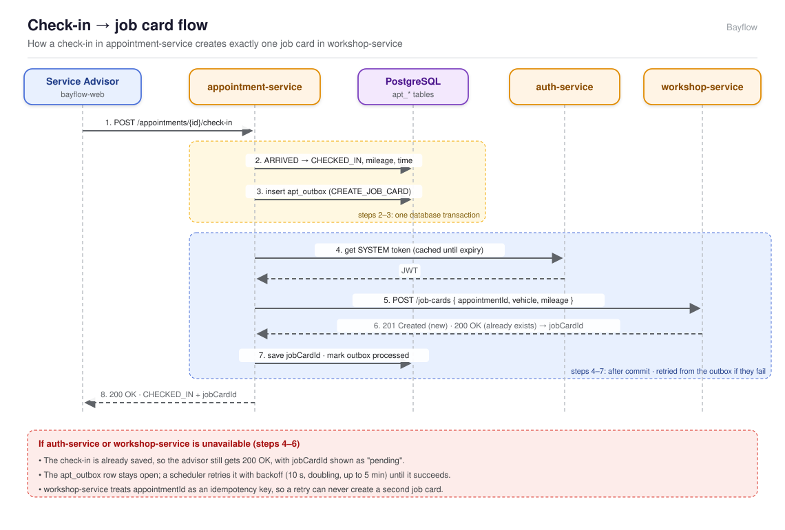

# Bayflow — Build Plan

Bayflow is a vehicle maintenance platform: customers book service appointments,
service advisors check vehicles in and manage job cards, mechanics log the work,
and every completed job becomes part of the vehicle's service history.

This plan is the agreed design. Each milestone is built on top of it and the
README records any assumption that changes along the way.

---

## 1. Versions

| Area | Choice | Notes |
|---|---|---|
| Java | 21 (LTS) | Temurin in CI and Docker images |
| Spring Boot | **4.1.2** | 3.x reached end of OSS support (3.5.16 was final), so Bayflow starts on 4.x |
| Spring Security | 7.1 (managed by Boot) | |
| Jackson | 3.x (managed by Boot) | packages are `tools.jackson.*` |
| Flyway | managed by Boot | Boot 4 needs the explicit `spring-boot-starter-flyway` |
| springdoc-openapi | 3.0.x | the 3.x line targets Spring Boot 4 |
| Testcontainers | 2.x (managed by Boot) | artifact `testcontainers-postgresql`, class `org.testcontainers.postgresql.PostgreSQLContainer` |
| PostgreSQL | 16 | |
| Node | 22 LTS, pnpm | frontend |
| React | 19 + TypeScript + Vite | |

Dependabot keeps every version current after the first build.

### Spring Boot 4 points to get right
- Use focused starters: `spring-boot-starter-webmvc` (not `-web`),
  `spring-boot-starter-flyway`, `spring-boot-starter-restclient`,
  `spring-boot-starter-oauth2-resource-server`, `spring-boot-starter-security`.
- Test starters per technology (`spring-boot-starter-webmvc-test`,
  `spring-boot-starter-security-test`, `spring-boot-starter-data-jpa-test`,
  `spring-boot-starter-flyway-test`) instead of one `spring-boot-starter-test`.
- Jackson 3 (`tools.jackson.databind.ObjectMapper`/`JsonMapper`).

---

## 2. Repository layout

```
bayflow/
├── backend/                      Maven multi-module build
│   ├── pom.xml                   bayflow-parent (Spring Boot 4.1.2 parent)
│   ├── common-security/          JWT validation config + role converter (no domain code)
│   ├── auth-service/             :8083  identity + token issuer
│   ├── appointment-service/      :8081  customers, vehicles, appointments
│   └── workshop-service/         :8082  job cards, work, service history
├── frontend/                     bayflow-web (React 19 + Vite)
├── infra/
│   ├── postgres/init/            creates schema `bayflow`
│   └── nginx/                    reverse proxy + SPA config
├── scripts/                      dev key generation, helpers
├── docs/                         this plan, architecture notes
├── docker-compose.yml            compose project `bayflow`
├── .env.example
└── .github/                      workflows + dependabot
```

Java packages: `com.bayflow.<service>.{api, application, domain, infrastructure}`
(e.g. `com.bayflow.appointment.domain`). Shared: `com.bayflow.security`.

---

## 3. Database

One PostgreSQL database `bayflow`, one schema `bayflow`.

| Owner | Prefix | Flyway history table |
|---|---|---|
| auth-service | `auth_` | `flyway_history_auth` |
| appointment-service | `apt_` | `flyway_history_appointment` |
| workshop-service | `ws_` | `flyway_history_workshop` |

Rules: a service only touches its own tables; no cross-service foreign keys;
data crosses boundaries through REST only. IDs are UUIDs (generated in Java).
Timestamps are `timestamptz` (`Instant` in Java). Money is `numeric(12,2)`
(`BigDecimal`). Every status-changing table has a `version bigint` column for
optimistic locking.

### Tables

**auth-service**
- `auth_users` (id, username unique, email unique, password_hash, enabled,
  failed_attempts, locked_until, created_at, updated_at)
- `auth_user_roles` (user_id, role)
- `auth_refresh_tokens` (id, user_id, family_id, token_hash unique, expires_at,
  revoked, replaced_by, created_at)
- `auth_clients` (client_id, secret_hash, roles, enabled)

**appointment-service**
- `apt_customers` (id, user_id unique, name, email, phone, created_at, version)
- `apt_vehicles` (id, customer_id → apt_customers, vin unique, registration,
  make, model, model_year, mileage, created_at, version)
- `apt_appointments` (id, customer_id, vehicle_id, scheduled_at, ends_at,
  duration_minutes, service_type, notes, status, arrival_mileage,
  confirmed_at, arrived_at, checked_in_at, cancelled_at, job_card_id,
  created_at, updated_at, version) — an exclusion constraint (`btree_gist`)
  stops overlapping active bookings for the same vehicle even under
  concurrent requests
- `apt_outbox` (id, aggregate_id, type, payload jsonb, attempts,
  next_attempt_at, last_error, processed_at, created_at)

**workshop-service**
- `ws_job_cards` (id, appointment_id unique, vehicle_id, vin, registration,
  customer_user_id, customer_name, mileage, status, submitted_at, decided_at,
  created_at, updated_at, version; milestone 5 adds parts_total,
  labour_total, grand_total, completed_at)
- `ws_inspection_findings` (id, job_card_id, description, severity
  LOW/MEDIUM/HIGH/CRITICAL, recorded_by, created_at)
- `ws_recommended_items` (id, job_card_id, description, estimated_parts_cost,
  estimated_labour_hours, approval_status, decided_by, decided_at, created_at)
- `ws_work_logs` (id, job_card_id, item_id, mechanic, description, completed_at)
- `ws_part_usages` (id, job_card_id, item_id, part_number, name, quantity,
  unit_price)
- `ws_labour_entries` (id, job_card_id, item_id, mechanic, hours, hourly_rate)
- `ws_service_history` (id, vehicle_id, job_card_id unique, service_date,
  mileage, summary jsonb, parts_total, labour_total, total_cost, created_at)
  — insert-only, never updated

---

## 4. State machines

### Appointment



Any other transition → `409 Conflict` (Problem Details, type `invalid-transition`).

### Job card



- Adding the first finding moves OPEN → INSPECTED.
- Submitting with zero recommendations moves the card straight to DECLINED
  (inspection only, see assumption 6).
- Approval status is computed once every item is decided:
  all approved → APPROVED, none approved → DECLINED, otherwise PARTIALLY_APPROVED.

Both machines live in the domain as pure Java (enum + transition table) so they
are unit-tested without Spring.

---

## 5. APIs

All under `/api/v1`, JSON, RFC 7807 errors, paginated lists use
`page`, `size`, `sort` and return `{content, page, size, totalElements, totalPages}`.

### auth-service (:8083)
| Method | Path | Who |
|---|---|---|
| POST | /auth/register | public (creates CUSTOMER) |
| POST | /auth/login | public |
| POST | /auth/refresh | refresh cookie |
| POST | /auth/logout | refresh cookie |
| GET | /auth/me | any authenticated |
| POST | /auth/token | client credentials (SYSTEM) |
| POST/GET | /auth/users | ADMIN |
| PATCH | /auth/users/{id} | ADMIN (enable/disable) |
| GET | /.well-known/jwks.json | public |

### appointment-service (:8081)
| Method | Path | Who |
|---|---|---|
| POST/GET | /customers/me | CUSTOMER |
| POST/GET | /customers, GET /customers/{id} | SERVICE_ADVISOR (ADMIN: GET only) |
| POST/GET | /vehicles, GET/PUT /vehicles/{id} | CUSTOMER (own), SERVICE_ADVISOR (ADMIN: GET only) |
| POST | /appointments | CUSTOMER (own vehicle), SERVICE_ADVISOR |
| GET | /appointments?date=&status=&vehicleId= | CUSTOMER (own), SERVICE_ADVISOR (all), MECHANIC (today's CHECKED_IN), ADMIN (all, read-only) |
| GET | /appointments/{id} | as above |
| POST | /appointments/{id}/confirm, /arrive, /check-in, /no-show | SERVICE_ADVISOR |
| POST | /appointments/{id}/cancel | CUSTOMER (own), SERVICE_ADVISOR |
| PATCH | /appointments/{id}/reschedule | CUSTOMER (own), SERVICE_ADVISOR |

### workshop-service (:8082)
| Method | Path | Who |
|---|---|---|
| POST | /job-cards | SYSTEM, SERVICE_ADVISOR (idempotent on appointmentId) |
| GET | /job-cards?status= , /job-cards/{id} | CUSTOMER (own), SERVICE_ADVISOR, MECHANIC, ADMIN |
| GET | /job-cards/by-appointment/{appointmentId} | as above, plus SYSTEM |
| POST | /job-cards/{id}/findings | SERVICE_ADVISOR, MECHANIC |
| POST | /job-cards/{id}/recommendations | SERVICE_ADVISOR |
| POST | /job-cards/{id}/submit-for-approval | SERVICE_ADVISOR |
| POST | /job-cards/{id}/recommendations/{itemId}/approve, /decline | CUSTOMER (own), SERVICE_ADVISOR |
| POST | /job-cards/{id}/start | MECHANIC |
| POST | /job-cards/{id}/work-logs, /parts, /labour | MECHANIC |
| POST | /job-cards/{id}/complete | SERVICE_ADVISOR, MECHANIC |
| GET | /service-history/vehicles/{vehicleId} | CUSTOMER (own), SERVICE_ADVISOR, MECHANIC, ADMIN |

---

## 6. Security model

- auth-service signs RS256 access tokens (15 min) with a `kid`; publishes the
  public key at `/.well-known/jwks.json`.
- Claims: `sub`, `username`, `roles`, `iss=bayflow-auth`, `aud=bayflow`,
  `iat`, `exp`, `jti`.
- Refresh tokens: opaque, 7 days, stored as SHA-256 hash, rotated on every use,
  reuse revokes the whole family.
- Public auth endpoints (register, login, refresh, logout, token) ignore any
  `Authorization` header, so a stale access token in the browser never blocks
  a refresh.
- Signing key from PEM files (`BAYFLOW_JWT_PRIVATE_KEY_PATH` /
  `BAYFLOW_JWT_PUBLIC_KEY_PATH`); in dev a throwaway key is generated when none
  is configured (`BAYFLOW_JWT_ALLOW_EPHEMERAL=false` disables that). Sent only as cookie `bayflow_rt`
  (`HttpOnly; Secure; SameSite=Strict; Path=/api/v1/auth`).
- Passwords: BCrypt. Login: rate limited per username + IP (Bucket4j, in
  memory); account locked for 15 minutes after 5 failures.
- Resource servers validate signature (JWKS), issuer and audience via
  `common-security`, map `roles` → `ROLE_*`, use `@PreAuthorize`, stateless,
  CSRF off. Ownership checks compare the JWT `sub` with `Customer.userId`
  (appointment) or `JobCard.customerUserId` (workshop); a foreign record
  returns 404 so its existence is not revealed.
- Service-to-service: appointment-service gets a SYSTEM token from
  `/auth/token` (client credentials) and caches it until 60 s before expiry.

---

## 7. Check-in → job card flow



Workshop returns `201` for a new job card and `200` with the existing one when
the appointmentId is already known, so retries are always safe.

---

## 8. UI (bayflow-web)

React 19 + TypeScript + Vite, React Router (data router), TanStack Query,
React Hook Form + Zod, Tailwind CSS + shadcn/ui, openapi-typescript clients,
in-memory access token with silent refresh. Served by nginx, which proxies
`/api/v1/*` to the right service (single origin, no CORS).

| Role | Screens |
|---|---|
| Public | Login, Register |
| CUSTOMER | Complete profile, My vehicles, Book appointment, My appointments, Approve work, Service history |
| SERVICE_ADVISOR | Today board (by status), Check-in dialog, Job cards list/detail, Customers, Service history |
| MECHANIC | My jobs queue, Job card detail (start, log work/parts/labour, complete) |
| ADMIN | User accounts (create, enable/disable), read-only views of appointments, job cards and history |

Shared job card detail page with a status timeline; actions shown per role.

Branding: name "Bayflow", tagline "The smarter way to run your auto workshop."
shown on the login and register pages, in the app header on wide screens, and
in the page `<meta name="description">`.

---

## 9. Assumptions

1. **Time zone**: the workshop runs in one time zone, `BAYFLOW_WORKSHOP_ZONE`
   (default `America/New_York`). "Today" and NO_SHOW checks use it, through an
   injectable `Clock` for tests.
2. **Slot length**: each appointment has `durationMinutes` (default 60);
   double booking = overlapping `[scheduledAt, scheduledAt + duration)` for the
   same vehicle among BOOKED/CONFIRMED/ARRIVED appointments.
3. **Mileage** is stored as an integer in miles; currency is a single
   configurable currency (default USD).
4. **ADMIN role**: ADMIN manages user accounts (create SERVICE_ADVISOR,
   MECHANIC or ADMIN accounts; enable/disable) and has read-only access to
   customers, appointments, job cards and history; it does not run workshop
   operations. Registration always creates CUSTOMER accounts. The first admin
   comes from `BAYFLOW_BOOTSTRAP_ADMIN_*` settings (created only while no admin
   exists); in dev the demo user `admin1` is seeded.
5. **Profile**: after registering, a customer creates their profile with
   `POST /customers/me`; the UI prompts for it on first login.
6. **Inspection-only jobs**: if no work is recommended, the advisor submits
   with zero items and the card goes straight to DECLINED, then COMPLETED,
   still producing a history entry with zero cost.
7. **Approval window**: items can only be approved/declined while the card is
   AWAITING_APPROVAL; a decision cannot be changed once made. When an advisor
   records a decision, `decidedBy` says "advisor1 (on behalf of the customer)".
   Estimates are parts cost + labour hours × `BAYFLOW_LABOUR_RATE`, rounded to
   cents; findings and recommendations are added only before submitting.
8. **Mechanic identity** on work, parts and labour comes from the JWT
   (`username`), not from the request body.
9. **Hourly rate** defaults from configuration (`BAYFLOW_LABOUR_RATE`) and can
   be overridden per labour entry.
10. **Dev seed users** (`customer1`, `advisor1`, `mechanic1`) load only under
    the `dev` profile and are documented in the README.
11. **Opening hours** are not enforced yet: any future time is bookable.
    Check-in mileage may not be lower than the vehicle's last reading, and it
    becomes the vehicle's new mileage.
12. **Rate limiting** is in memory (one auth-service instance). Running several
    instances would need a shared store such as Redis.
13. **Concurrent refreshes**: two tabs refreshing with the same cookie at the
    same moment look like token reuse and end the session; the frontend
    (milestone 6) de-duplicates refresh calls to avoid this.

---

## 10. Milestones

| # | Scope | Done when |
|---|---|---|
| 1 | Monorepo skeleton: parent POM, compose (Postgres + `bayflow` schema), CI skeleton, Dependabot, README | `mvn -f backend/pom.xml verify` passes; `docker compose up -d` gives a healthy Postgres with the schema |
| 2 | common-security + auth-service | register/login/refresh/logout/token/JWKS work with tests |
| 3 | appointment-service | appointment workflow + security + Testcontainers tests |
| 4 | workshop-service: job card, inspection, approval | approval workflow + security tests |
| 5 | Work logging, completion, history + check-in integration (outbox) | end-to-end backend workflow tests pass |
| 6 | Frontend foundation: auth flow, layout, routing, API clients | login works against the backend |
| 7 | Frontend screens for all three roles | full workflow possible in the UI |
| 8 | nginx hardening, full compose, Playwright e2e, CD workflow, README | `docker compose up --build` + e2e green |

Each milestone ends with a review pause.
