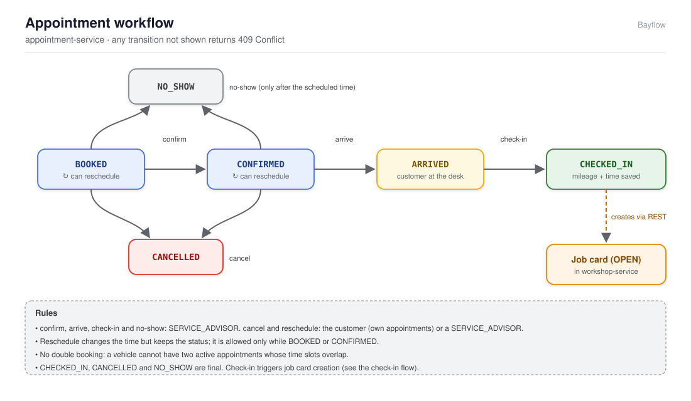
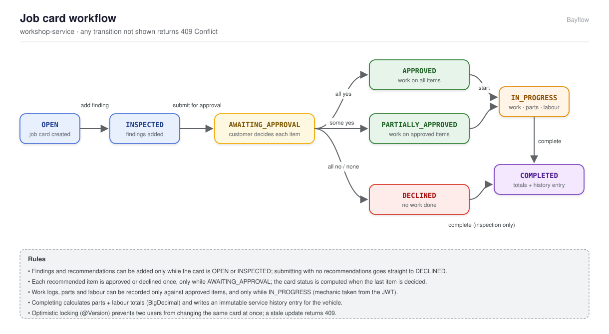
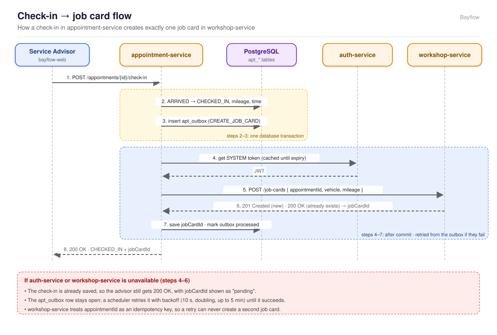

# Bayflow — Build Plan

Bayflow is a vehicle maintenance platform: customers book service appointments,
service advisors check vehicles in and manage job cards, mechanics log the work,
and every completed job becomes part of the vehicle's service history.

This plan is the agreed design. Each milestone is built on top of it and the
README records any assumption that changes along the way.

---

## 1. Versions

| Area | Choice | Notes |
|---|---|---|
| Java | 21 (LTS) | Temurin in CI and Docker images |
| Spring Boot | **4.1.2** | 3.x reached end of OSS support (3.5.16 was final), so Bayflow starts on 4.x |
| Spring Security | 7.1 (managed by Boot) | |
| Jackson | 3.x (managed by Boot) | packages are `tools.jackson.*` |
| Flyway | managed by Boot | Boot 4 needs the explicit `spring-boot-starter-flyway` |
| springdoc-openapi | 3.0.x | the 3.x line targets Spring Boot 4 |
| Testcontainers | 2.x (managed by Boot) | artifact `testcontainers-postgresql`, class `org.testcontainers.postgresql.PostgreSQLContainer` |
| PostgreSQL | 16 | |
| Node | 22 LTS, pnpm | frontend |
| React | 19 + TypeScript + Vite | |

Dependabot keeps every version current after the first build.

### Spring Boot 4 points to get right
- Use focused starters: `spring-boot-starter-webmvc` (not `-web`),
  `spring-boot-starter-flyway`, `spring-boot-starter-restclient`,
  `spring-boot-starter-oauth2-resource-server`, `spring-boot-starter-security`.
- Test starters per technology (`spring-boot-starter-webmvc-test`,
  `spring-boot-starter-security-test`, `spring-boot-starter-data-jpa-test`,
  `spring-boot-starter-flyway-test`) instead of one `spring-boot-starter-test`.
- Jackson 3 (`tools.jackson.databind.ObjectMapper`/`JsonMapper`).

---

## 2. Repository layout

```
bayflow/
├── backend/                      Maven multi-module build
│   ├── pom.xml                   bayflow-parent (Spring Boot 4.1.2 parent)
│   ├── common-security/          JWT validation config + role converter (no domain code)
│   ├── auth-service/             :8083  identity + token issuer
│   ├── appointment-service/      :8081  customers, vehicles, appointments
│   └── workshop-service/         :8082  job cards, work, service history
├── frontend/                     bayflow-web (React 19 + Vite)
├── infra/
│   ├── postgres/init/            creates schema `bayflow`
│   └── nginx/                    reverse proxy + SPA config
├── scripts/                      dev key generation, helpers
├── docs/                         this plan, architecture notes
├── docker-compose.yml            compose project `bayflow`
├── .env.example
└── .github/                      workflows + dependabot
```

Java packages: `com.bayflow.<service>.{api, application, domain, infrastructure}`
(e.g. `com.bayflow.appointment.domain`). Shared: `com.bayflow.security`.

---

## 3. Database

One PostgreSQL database `bayflow`, one schema `bayflow`.

| Owner | Prefix | Flyway history table |
|---|---|---|
| auth-service | `auth_` | `flyway_history_auth` |
| appointment-service | `apt_` | `flyway_history_appointment` |
| workshop-service | `ws_` | `flyway_history_workshop` |

Rules: a service only touches its own tables; no cross-service foreign keys;
data crosses boundaries through REST only. IDs are UUIDs (generated in Java).
Timestamps are `timestamptz` (`Instant` in Java). Money is `numeric(12,2)`
(`BigDecimal`). Every status-changing table has a `version bigint` column for
optimistic locking.

### Tables

**auth-service**
- `auth_users` (id, username unique, email unique, password_hash, enabled,
  failed_attempts, locked_until, created_at, updated_at)
- `auth_user_roles` (user_id, role)
- `auth_refresh_tokens` (id, user_id, family_id, token_hash unique, expires_at,
  revoked, replaced_by, created_at)
- `auth_clients` (client_id, secret_hash, roles, enabled)

**appointment-service**
- `apt_customers` (id, user_id unique, name, email, phone, created_at, version)
- `apt_vehicles` (id, customer_id → apt_customers, vin unique, registration,
  make, model, model_year, mileage, created_at, version)
- `apt_appointments` (id, customer_id, vehicle_id, scheduled_at, ends_at,
  duration_minutes, service_type, notes, status, arrival_mileage,
  confirmed_at, arrived_at, checked_in_at, cancelled_at, job_card_id,
  created_at, updated_at, version) — an exclusion constraint (`btree_gist`)
  stops overlapping active bookings for the same vehicle even under
  concurrent requests
- `apt_outbox` (id, aggregate_id, type, payload jsonb, attempts,
  next_attempt_at, last_error, processed_at, created_at)

**workshop-service**
- `ws_job_cards` (id, appointment_id unique, vehicle_id, vin, registration,
  customer_user_id, customer_name, mileage, status, submitted_at, decided_at,
  created_at, updated_at, version; milestone 5 adds parts_total,
  labour_total, grand_total, completed_at)
- `ws_inspection_findings` (id, job_card_id, description, severity
  LOW/MEDIUM/HIGH/CRITICAL, recorded_by, created_at)
- `ws_recommended_items` (id, job_card_id, description, estimated_parts_cost,
  estimated_labour_hours, approval_status, decided_by, decided_at, created_at)
- `ws_work_logs` (id, job_card_id, item_id, mechanic, description, completed_at)
- `ws_part_usages` (id, job_card_id, item_id, part_number, name, quantity,
  unit_price)
- `ws_labour_entries` (id, job_card_id, item_id, mechanic, hours, hourly_rate)
- `ws_service_history` (id, vehicle_id, job_card_id unique, service_date,
  mileage, summary jsonb, parts_total, labour_total, total_cost, created_at)
  — insert-only, never updated

---

## 4. State machines

### Appointment



Any other transition → `409 Conflict` (Problem Details, type `invalid-transition`).

### Job card



- Adding the first finding moves OPEN → INSPECTED.
- Submitting with zero recommendations moves the card straight to DECLINED
  (inspection only, see assumption 6).
- Approval status is computed once every item is decided:
  all approved → APPROVED, none approved → DECLINED, otherwise PARTIALLY_APPROVED.

Both machines live in the domain as pure Java (enum + transition table) so they
are unit-tested without Spring.

---

## 5. APIs

All under `/api/v1`, JSON, RFC 7807 errors, paginated lists use
`page`, `size`, `sort` and return `{content, page, size, totalElements, totalPages}`.

### auth-service (:8083)
| Method | Path | Who |
|---|---|---|
| POST | /auth/register | public (creates CUSTOMER) |
| POST | /auth/login | public |
| POST | /auth/refresh | refresh cookie + `X-Bayflow-Client` header (CSRF) |
| POST | /auth/logout | refresh cookie + `X-Bayflow-Client` header (CSRF) |
| GET | /auth/me | any authenticated |
| POST | /auth/token | client credentials (SYSTEM) |
| POST/GET | /auth/users | ADMIN |
| PATCH | /auth/users/{id} | ADMIN (enable/disable) |
| GET | /.well-known/jwks.json | public |
| GET | /auth/tenant | any signed-in user (their workshop and its settings) |
| PUT | /auth/tenant/settings | ADMIN (with the `version` read; 409 if stale) |
| GET | /auth/internal/tenants/{id}/settings | SYSTEM only; nginx returns 404 for `/api/v1/auth/internal/` |
| POST | /tenants/signup | public (CSRF header, rate-limited per IP): new workshop + its ADMIN |
| GET | /tenants/slug-availability?slug= | public |
| GET | /tenants/current | public: the workshop at this address (404 if none), with its `branding` |
| GET | /auth/internal/tenants/{tid}/locations/{lid}/staff?roles= | SYSTEM only: enabled staff with those roles at the location |
| GET | /tenants/current/logo, /tenants/current/cover | public: the workshop's images (ETag; `?v=` from `/tenants/current` = cached a year) |
| GET/PUT | /auth/tenant/branding | ADMIN: colour, announcement, "Powered by Bayflow" (PUT with `version`; 409 if stale) |
| PUT/DELETE | /auth/tenant/branding/logo, /auth/tenant/branding/cover | ADMIN: upload (multipart `file`) or remove an image |

### appointment-service (:8081)
| Method | Path | Who |
|---|---|---|
| POST/GET | /customers/me | CUSTOMER |
| POST/GET | /customers, GET /customers/{id} | SERVICE_ADVISOR (ADMIN: GET only) |
| POST/GET | /vehicles, GET/PUT /vehicles/{id} | CUSTOMER (own), SERVICE_ADVISOR (ADMIN: GET only) |
| POST | /appointments | CUSTOMER (own vehicle), SERVICE_ADVISOR |
| GET | /appointments?date=&status=&vehicleId= | CUSTOMER (own), SERVICE_ADVISOR (all), MECHANIC (today's CHECKED_IN), ADMIN (all, read-only) |
| GET | /appointments/{id} | as above |
| POST | /appointments/{id}/confirm, /arrive, /check-in, /no-show | SERVICE_ADVISOR |
| POST | /appointments/{id}/cancel | CUSTOMER (own), SERVICE_ADVISOR |
| PATCH | /appointments/{id}/reschedule | CUSTOMER (own), SERVICE_ADVISOR |

### workshop-service (:8082)
| Method | Path | Who |
|---|---|---|
| POST | /job-cards | SYSTEM, SERVICE_ADVISOR (idempotent on appointmentId) |
| GET | /job-cards?status= , /job-cards/{id} | CUSTOMER (own), SERVICE_ADVISOR, MECHANIC, ADMIN |
| GET | /job-cards/by-appointment/{appointmentId} | as above, plus SYSTEM |
| POST | /job-cards/{id}/findings | SERVICE_ADVISOR, MECHANIC |
| POST | /job-cards/{id}/recommendations | SERVICE_ADVISOR |
| POST | /job-cards/{id}/submit-for-approval | SERVICE_ADVISOR |
| POST | /job-cards/{id}/recommendations/{itemId}/approve, /decline | CUSTOMER (own), SERVICE_ADVISOR |
| POST | /job-cards/{id}/start | MECHANIC |
| POST | /job-cards/{id}/work-logs, /parts, /labour | MECHANIC |
| POST | /job-cards/{id}/complete | SERVICE_ADVISOR, MECHANIC |
| GET | /service-history/vehicles/{vehicleId} | CUSTOMER (own), SERVICE_ADVISOR, MECHANIC, ADMIN |

---

## 6. Security model

- auth-service signs RS256 access tokens (15 min) with a `kid`; publishes the
  public key at `/.well-known/jwks.json`.
- Claims: `sub`, `username`, `roles`, `iss=bayflow-auth`, `aud=bayflow`,
  `iat`, `exp`, `jti`.
- Refresh tokens: opaque, 7 days, stored as SHA-256 hash, rotated on every use,
  reuse revokes the whole family.
- Public auth endpoints (register, login, refresh, logout, token) ignore any
  `Authorization` header, so a stale access token in the browser never blocks
  a refresh.
- Signing key from PEM files (`BAYFLOW_JWT_PRIVATE_KEY_PATH` /
  `BAYFLOW_JWT_PUBLIC_KEY_PATH`); in dev a throwaway key is generated when none
  is configured (`BAYFLOW_JWT_ALLOW_EPHEMERAL=false` disables that). Sent only as cookie `bayflow_rt`
  (`HttpOnly; Secure; SameSite=Strict; Path=/api/v1/auth`).
- Passwords: BCrypt. Login: rate limited per username + IP (Bucket4j, in
  memory); account locked for 15 minutes after 5 failures.
- Resource servers validate signature (JWKS), issuer and audience via
  `common-security`, map `roles` → `ROLE_*`, use `@PreAuthorize`, stateless,
  CSRF off. Ownership checks compare the JWT `sub` with `Customer.userId`
  (appointment) or `JobCard.customerUserId` (workshop); a foreign record
  returns 404 so its existence is not revealed.
- Service-to-service: appointment-service gets a SYSTEM token from
  `/auth/token` (client credentials) and caches it until 60 s before expiry.

---

## 7. Check-in → job card flow



Workshop returns `201` for a new job card and `200` with the existing one when
the appointmentId is already known, so retries are always safe.

---

## 8. UI (bayflow-web)

React 19 + TypeScript + Vite, React Router (data router), TanStack Query,
React Hook Form + Zod, Tailwind CSS + shadcn/ui, openapi-typescript clients,
in-memory access token with silent refresh. Served by nginx, which proxies
`/api/v1/*` to the right service (single origin, no CORS).

| Role | Screens |
|---|---|
| Public | Login, Register |
| CUSTOMER | Complete profile, My vehicles, Book appointment, My appointments, Approve work, Service history |
| SERVICE_ADVISOR | Today board (by status), Check-in dialog, Job cards list/detail, Customers, Service history |
| MECHANIC | My jobs queue, Job card detail (start, log work/parts/labour, complete) |
| ADMIN | User accounts (create, enable/disable), read-only views of appointments, job cards and history |

Shared job card detail page with a status timeline; actions shown per role.

Frontend foundation (milestone 6):
- Dev server on http://localhost:5173 proxies `/api/v1/*` to the services, like nginx does in Docker.
- `src/api/http.ts`: in-memory token, one shared refresh on 401 then retry, Problem Details → `ApiError`.
- `AuthProvider` restores the session from the refresh cookie on load and refreshes 60 s before expiry.
- Route guards (`RequireAuth`, `RequireRole`) mirror the API's role rules; navigation shows only the
  current role's screens.
- API types: `pnpm api:update` (services running) downloads the OpenAPI documents and generates
  `src/api/schema/*.ts`; `src/api/types.ts` builds on them and marks the fields the backend always
  sends as required.

Screens (milestone 7), under `src/features/`:
- Customers: profile setup on first sign-in, My vehicles (add, edit, service history), Book a
  service, Appointments (reschedule, cancel), Job cards with approve/decline per item.
- Service advisor: Today's board (columns by status; confirm, arrive, check-in dialog, no-show),
  Appointments with day/status filters, Customers (search, create, vehicles, bookings), job card
  findings, recommendations, submit, decisions on the customer's behalf, complete.
- Mechanic: My jobs (needs inspection / ready to start / in progress), findings, start, work logs,
  parts, labour, complete.
- Admin: User accounts (create staff, enable/disable); read-only appointments, customers and job
  cards.

Branding: name "Bayflow", tagline "The smarter way to run your auto workshop."
shown on the login and register pages, in the app header on wide screens, and
in the page `<meta name="description">`.

---

## 8b. Delivery (milestone 8)

- **bayflow-web image** (`frontend/Dockerfile`): the Vite build served by unprivileged nginx on
  port 8080 (compose maps it to http://localhost:3000). `infra/nginx/` holds the config:
  - routes `/api/v1/auth` and `/.well-known/jwks.json` → auth-service,
    `/api/v1/{customers,vehicles,appointments}` → appointment-service,
    `/api/v1/{job-cards,service-history}` → workshop-service (upstreams set by environment)
  - passes the real client IP and scheme (`X-Forwarded-*`), API responses `no-store`
  - SPA fallback to `index.html` (never cached); hashed `/assets/*` cached for a year; gzip
  - security headers on every response: CSP without inline scripts (the theme script is a file),
    `X-Frame-Options: DENY`, `nosniff`, referrer and permissions policies
  - `/healthz` for the container health check
- **Compose** starts PostgreSQL → auth-service → appointment- and workshop-service → web, each
  waiting for the previous to be healthy.
- **Playwright** (`frontend/e2e/`) runs the full workflow through the UI against the compose stack,
  with the customer, advisor and mechanic in separate browser sessions.
- **CI** adds an e2e job after the backend and frontend jobs; **CD** pushes the four images to
  GHCR after CI passes on `main`.

## 9. Assumptions

1. **Time zone**: the workshop runs in one time zone, `BAYFLOW_WORKSHOP_ZONE`
   (default `America/New_York`). "Today" and NO_SHOW checks use it, through an
   injectable `Clock` for tests.
2. **Slot length**: each appointment has `durationMinutes` (default 60);
   double booking = overlapping `[scheduledAt, scheduledAt + duration)` for the
   same vehicle among BOOKED/CONFIRMED/ARRIVED appointments.
3. **Mileage** is stored as an integer in miles; currency is a single
   configurable currency (default USD).
4. **ADMIN role**: ADMIN manages user accounts (create SERVICE_ADVISOR,
   MECHANIC or ADMIN accounts; enable/disable) and has read-only access to
   customers, appointments, job cards and history; it does not run workshop
   operations. Registration always creates CUSTOMER accounts. The first admin
   comes from `BAYFLOW_BOOTSTRAP_ADMIN_*` settings (created only while no admin
   exists); in dev the demo user `admin1` is seeded.
5. **Profile**: after registering, a customer creates their profile with
   `POST /customers/me`; the UI prompts for it on first login.
6. **Inspection-only jobs**: if no work is recommended, the advisor submits
   with zero items and the card goes straight to DECLINED, then COMPLETED,
   still producing a history entry with zero cost.
7. **Approval window**: items can only be approved/declined while the card is
   AWAITING_APPROVAL; a decision cannot be changed once made. When an advisor
   records a decision, `decidedBy` says "advisor1 (on behalf of the customer)".
   Estimates are parts cost + labour hours × `BAYFLOW_LABOUR_RATE`, rounded to
   cents; findings and recommendations are added only before submitting.
8. **Mechanic identity** on work, parts and labour comes from the JWT
   (`username`), not from the request body.
9. **Hourly rate** defaults from configuration (`BAYFLOW_LABOUR_RATE`) and can
   be overridden per labour entry.
10. **Dev seed users** (`customer1`, `advisor1`, `mechanic1`) load only under
    the `dev` profile and are documented in the README.
11. **Opening hours** are not enforced yet: any future time is bookable.
    Check-in mileage may not be lower than the vehicle's last reading, and it
    becomes the vehicle's new mileage.
12. **Rate limiting** is in memory (one auth-service instance). Running several
    instances would need a shared store such as Redis.
13. **Concurrent refreshes**: two tabs refreshing with the same cookie at the
    same moment look like token reuse and end the session; the frontend
    (milestone 6) de-duplicates refresh calls to avoid this.
14. **Completing a job** needs at least one work log for every approved
    recommendation. Parts and labour are optional per item. Labour entries use
    the workshop rate unless the mechanic enters another rate.
15. **Service history** entries are written in the same transaction as the
    completion and never change. They store a snapshot (findings, work done,
    declined items, parts, labour, totals). Customers see entries from jobs on
    their own account.
16. **Job-card delivery** is at-least-once: the immediate attempt after check-in
    and the scheduled retry may both send the same request; workshop-service is
    idempotent on the appointment id, so only one job card ever exists.
17. **Multi-tenancy (SaaS), phase 1** (see `docs/prompts/saas-local.md`): every
    business row carries a `tenant_id` and every user token a `tid` claim.
    - Tenants live in auth-service (`auth_tenants`); other services learn the
      tenant only from the token. Data from before multi-tenancy belongs to the
      `default` workshop, id `00000000-0000-0000-0000-000000000001` (Flyway
      placeholder `default_tenant_id`, the same in every service).
    - Hibernate's `@TenantId` fills and filters `tenant_id` on every entity.
      When no tenant is known, `BayflowTenantResolver` (common-security) uses
      the reserved id `ffffffff-ffff-ffff-ffff-ffffffffffff`: no row has it, so
      reads find nothing, and a CHECK on every `tenant_id` (migrations `V3_1`)
      refuses it and the root id, so writes fail. A missing tenant fails closed.
      (The resolver can't simply throw: Spring Data opens sessions without a
      tenant while starting up.)
    - `TenantContext` sets the tenant where there is no user token: sign-in,
      registration and refresh (the request's workshop, always `default` until
      phase 4), SYSTEM job-card requests (`tenantId` in the body, trusted only
      from SYSTEM), and the outbox retry job (each message in its own workshop).
      Only service clients and finding due outbox rows run across tenants.
    - Usernames, emails and VINs are unique per workshop, not globally.
    - `auth_user_roles.tenant_id` is filled by a trigger from the user, because
      the JPA element collection inserts only `(user_id, role)`.
    - A user token without `tid` gets 401, so sessions from before this change
      must sign in again once. SYSTEM tokens carry no `tid`.
    - Deferred to phase 4 (needs one address per workshop): seeding the `demo`
      and `acme` workshops and the two-workshop Playwright scenario.
18. **Multi-tenancy (SaaS), phase 2: row-level security.**
    - Two database logins. The table owner (`bayflow`, `POSTGRES_USER`) is used
      only by Flyway (`spring.flyway.user`). The services run as `bayflow_app`:
      no superuser, no BYPASSRLS, owns nothing. It is created by
      `infra/postgres/init/02-create-app-role.sh` (new volumes) or
      `scripts/upgrade-local-db.*` (existing ones); each service's `V4`
      migration grants it access to that service's tables (placeholder `app_role`).
    - Every table with a `tenant_id` has RLS enabled and a policy
      `tenant_id = NULLIF(current_setting('app.tenant', true), '')::uuid` for
      reads and writes. `TenantAwareJpaTransactionManager` runs
      `set_config('app.tenant', <tenant>, true)` as each transaction starts;
      the setting is transaction-local, so pooled connections never carry it.
      No tenant set means no rows.
    - RLS is enabled, not forced: the owner is exempt, so migrations and the
      owner-run `SECURITY DEFINER` function `apt_due_outbox` see all rows (on
      AWS RDS the owner is not a superuser, so FORCE would break both).
      `RowLevelSecurityGuard` refuses to start a service whose login is a
      superuser, has BYPASSRLS, or owns tables.
    - The outbox retry job is the only cross-workshop read: `apt_due_outbox`
      returns ids and workshops of due messages; each is then handled inside
      its own workshop. `GET /job-cards/by-appointment` no longer accepts SYSTEM
      tokens (nothing used it; it would have needed another cross-workshop read).
    - Tests run as `bayflow_app` too; checks that must see every workshop use
      an owner connection.
19. **Multi-tenancy (SaaS), phase 3: per-workshop settings.**
    - auth-service owns `auth_tenant_settings` (one row per workshop, RLS like
      every other table): display name, phone, email, address, labour rate,
      currency (ISO 4217) and time zone (IANA). `V5` creates a row for every
      existing workshop from `BAYFLOW_LABOUR_RATE` / `BAYFLOW_CURRENCY` /
      `BAYFLOW_WORKSHOP_ZONE`; a workshop without a row gets one from the same
      defaults on first read. Updates carry the `version` read (optimistic
      locking, 409 `concurrent-update`); unknown currencies and zones are 400s.
    - appointment-service and workshop-service read settings through
      `GET /api/v1/auth/internal/tenants/{id}/settings` with their own SYSTEM
      logins (`appointment-service`, and the new `workshop-service` client with
      `BAYFLOW_WORKSHOP_CLIENT_SECRET`), cached 5 minutes per workshop.
    - **Time zone:** appointment-service uses the workshop's zone for "today"
      and date filters. If auth-service can't be reached it falls back to
      `BAYFLOW_WORKSHOP_ZONE`, so lists keep working.
    - **Money is frozen:** `ws_job_cards.labour_rate` and `currency` are set
      when the card opens and never change; history entries copy the currency.
      Changing the settings affects new job cards only. workshop-service
      refuses to open a card without confirmed settings (503
      `settings-unavailable`); the check-in outbox retries it. `V5` fills
      existing cards and history from the old env values.
    - The web app loads the workshop once after sign-in: its name in the
      header, every date and time shown and entered in its zone, amounts in the
      card's currency. ADMINs edit it under *Workshop settings*.
    - Still from env after phase 3: only the defaults for new workshops and the
      appointment-service fallback zone; no business setting is read from env
      at request time while auth-service is up.
20. **Multi-tenancy (SaaS), phase 4: sign-up and workshop addresses.**
    - A workshop lives at `<slug>.<BAYFLOW_BASE_DOMAIN>` (`demo.localhost:3000`);
      the bare base domain is the public site (landing page, sign-up) and never
      holds a session. Browsers resolve `*.localhost` themselves; nginx and the
      Vite dev server serve every host and pass it on in `X-Forwarded-Host`.
    - `V6` renames the original `default` workshop to `demo` (same id and data).
      Slugs never change, because tokens and addresses refer to them. The dev
      profile also seeds `acme` (fixed id) with the same four demo users.
    - auth-service finds the workshop of sign-in, registration, refresh and
      sign-out from the address (`RequestTenants`): unknown → 404
      `workshop-not-found`; SUSPENDED → 403 `workshop-suspended` (sign-out still
      works; issued access tokens run out within 15 minutes). Addresses with no
      workshop label (Swagger UI on :8083, scripts) use
      `BAYFLOW_FALLBACK_WORKSHOP` (`demo` in dev, empty otherwise → 404).
    - Tokens add `tsl` (the slug). `WorkshopHostFilter` (common-security, all
      three services) refuses a user token at another workshop's address with
      401 `workshop-mismatch`, and a token without `tsl` at any workshop address.
      Addresses without a workshop label and SYSTEM tokens are not checked; the
      `tid` claim remains the only source of the tenant.
    - `POST /api/v1/tenants/signup` (public, CSRF header required, 10 per IP per
      hour by default, 30 in local compose for repeated e2e runs, in memory per
      instance) creates the workshop, its settings and its first ADMIN in one
      transaction, inside the new workshop's tenant context so row-level
      security accepts the rows. Slug rules: 3–30 of `a-z`, `0-9` and single
      hyphens, no hyphen at either end, unique, not reserved (www, api, admin,
      auth, default, status, mail, help, …). `GET /api/v1/tenants/slug-availability`
      checks live; `GET /api/v1/tenants/current` names the workshop for its
      sign-in page. Losing a race on the slug is a 409, not a 500.
    - Login rate limits are per workshop, username and IP (the same username in
      two workshops is two people).
    - Refresh cookies keep no `Domain` attribute, so each workshop address has
      its own session and the public site has none.
    - Not built (see docs/SAAS-AWS-NOTES.md): a platform-admin UI to suspend or
      delete workshops (SQL for now), email verification of sign-ups, custom
      domains per workshop, a shared rate-limit store.
21. **Organizations and locations, phase L1: locations exist** (prompt:
    `docs/prompts/organizations-locations.md`). A tenant is now an
    *organization* with one or more *locations* (shops); nothing visible changes
    while an organization has one.
    - auth `V7`: `auth_locations` (code unique per organization, contact details,
      optional time-zone and labour-rate overrides, ACTIVE/ARCHIVED; RLS like
      every per-tenant table). Every existing organization got **"Main" (code
      `main`) whose id is the tenant id**. That is deliberate: the other services
      fill in `location_id = tenant_id` on their own rows (appointment `V5`,
      workshop `V6`) without reading auth tables. Sign-up and the dev seeding create
      Main the same way; an organization without a location gets it on first use.
    - Effective settings: a location's own time zone / labour rate, else the
      organization's. Currency is organization-wide only.
    - `location_id` (NOT NULL, indexed after `tenant_id`) on `apt_appointments`,
      `ws_job_cards` and `ws_service_history`; it is copied from the appointment
      through the check-in outbox payload to the job card and its history entry.
      Payloads queued before L1 fall back to the tenant id (= Main). Customers and
      vehicles stay organization-wide; the "no overlapping bookings" rule stays per
      vehicle across all locations (a car is in one shop at a time).
    - Booking: `locationId` optional while the organization has one active location,
      otherwise 400 `location-required`; unknown, archived or another organization's
      location → 400 `invalid-location`. If auth-service is down, only Main takes
      bookings (others: 503 `locations-unavailable`).
    - Lists: `date` and "today" use the location in `locationId` (which also limits
      the list), else the organization's default location (Main); fallback zone
      `BAYFLOW_WORKSHOP_ZONE` while auth-service is down.
    - Job cards freeze **their location's** effective labour rate plus the
      organization's currency (`locationId` in the open request; none = Main; a
      location that is not the organization's → 400 `invalid-location`; settings
      unavailable → 503, the outbox retries).
    - New endpoints: `GET /api/v1/auth/locations` (any signed-in user) and SYSTEM-only
      `GET /api/v1/auth/internal/tenants/{tid}/locations` and
      `…/locations/{lid}/settings`. appointment-service's `LocationsClient`
      replaces its workshop-settings client; workshop-service's settings client now
      reads per location. Both cache for 5 minutes.
    - Responses add `locationId` (appointments, job cards, job-card summaries,
      service history); location names come from `/auth/locations` in the UI (L3).
22. **Organizations and locations, phase L2: scoped access.**
    - Roles: ADMIN (owner) and CUSTOMER work with every location; MANAGER (new:
      a location's manager, or a regional manager of several), SERVICE_ADVISOR
      and MECHANIC work at the locations in `auth_user_locations` (auth `V8`;
      existing advisors and mechanics were given "Main"). A MANAGER also gets the
      SERVICE_ADVISOR authority (token converter, and `effectiveRoles` in the web
      app), so every advisor permission applies to managers.
    - Tokens carry `lsc`: `["*"]` or the location ids (at most 200). Location
      changes apply from the next token (≤ 15 minutes). Staff without a location
      can't sign in (403 `no-locations`); a staff token without `lsc` is refused
      (401), like one without `tid`.
    - `POST /api/v1/auth/users` takes `locationIds` (none = the organization's only
      active location, else 400 `locations-required`); `PUT
      /api/v1/auth/users/{id}/locations` (ADMIN) changes them. Unknown or archived
      locations → 400 `invalid-location`; ADMIN accounts take none (400
      `not-location-scoped`). There is no role-change endpoint, so "an admin can't
      remove their own ADMIN role" holds trivially.
    - common-security: `LocationScope` / `LocationContext`; `LocationScopeFilter`
      reads `X-Bayflow-Location: <id>|all` and only narrows (403
      `location-not-allowed`); `TenantAwareJpaTransactionManager` sets
      `app.locations` (`*`, id list, or empty) per transaction with `app.tenant`.
      SYSTEM tokens and background work inside an explicit tenant use `*`.
    - RLS: `apt_appointments` (appointment `V6`) and `ws_job_cards`, its child
      tables and `ws_service_history` (workshop `V7`) check
      `tenant_id AND (app.locations = '*' OR location_id = ANY(...))` (a CASE keeps
      the `*` from being cast). The job card's child tables got their own
      `location_id`, kept equal to the card's by a composite foreign key
      `(job_card_id, location_id) → ws_job_cards (id, location_id)`. Customers,
      vehicles and the outbox stay organization-wide.
    - Services also check the location of every appointment and job card they load
      (404 outside the scope), and bookings / job-card opening refuse locations
      outside it (404). Without a location, a one-location scope books there.
23. **Organizations and locations, phase L3: multi-location in the web app.**
    - ADMIN manages locations (`POST /api/v1/auth/locations`, `PUT …/{id}` with
      `version`, `POST …/{id}/archive` and `/reactivate`): code unique per
      organization, optional time-zone and labour-rate overrides (empty = the
      workshop's). Archiving is refused for the last active location (409
      `last-location`) and while appointment-service reports upcoming (booked,
      confirmed or arrived) appointments there (409 `location-has-appointments`;
      503 if it can't be asked). auth-service calls appointment-service's
      SYSTEM-only `GET /api/v1/internal/tenants/{tid}/locations/{lid}/upcoming`
      with a SYSTEM token it signs itself (`BAYFLOW_APPOINTMENT_URL`); nginx does
      not route `/api/v1/internal/`. Customers only see active locations.
    - appointment-service fetches the locations again once when asked for one it
      doesn't know (a location added since its 5-minute cache), so new locations
      take bookings at once. Likewise, before answering `location-required` (no location
      given and not exactly one to choose), it fetches them again once, so a location
      archived within the last 5 minutes no longer makes customers choose. Rate and
      time-zone edits reach it within 5 minutes.
    - Web app:
      - *Locations* page (ADMIN): list, add, edit, archive, reactivate.
      - *User accounts*: Manager role; a "Works at" checklist when the
        organization has several locations; *Locations* per staff member.
      - Location switcher in the header for staff with more than one location
        ("All locations" or one), remembered per user in the browser and sent as
        `X-Bayflow-Location` on every API call.
      - Times are shown in each record's location's zone; booking and
        rescheduling read the time in the location's zone; booking offers a
        location choice (preselected: the switcher's, else the first by name).
      - Lists over all locations filter a day by each booking's own location's day
        (an Auckland booking on the 23rd shows under the 23rd, even while it is the 22nd in
        New York); a mechanic's "today" likewise. One location: that location's day.
      - The board always shows one location (the switcher's, or a picker on the
        page when "All" is selected), because a day belongs to one time zone.
      - With one location, none of this appears.
    - e2e: `08-locations.spec.ts` adds a location, staffs it, books there and
      archives it again; the booking helper sends Main's id while an organization
      has several locations, so other scenarios are unaffected.

24. **Branding (white label).** A workshop's ADMIN sets, in *Workshop settings → Branding*:
    logo, sign-in cover photo, brand colour, a one-line announcement with optional dates, and
    whether "Powered by Bayflow" shows. Stored in auth-service (`V9`): `auth_tenant_branding`
    (one row per workshop, `version` for optimistic locking) and `auth_tenant_assets` (the
    images, `bytea`, with their SHA-256), both with RLS like every per-workshop table.
    - **Images:** PNG and JPEG only, recognised by their first bytes (not the name or the
      declared type); SVG is refused because it can carry scripts. Each upload is decoded
      and written again with `javax.imageio` (no new dependency): metadata (EXIF, GPS) and
      anything appended after the image data are dropped. Images claiming more than 40
      megapixels are refused before decoding. Logo: up to 1 MB, scaled to fit 512×512 px,
      stored as PNG (transparency kept). Cover: up to 3 MB, scaled to at most 2000 px, stored
      as JPEG (quality 0.85; transparency becomes white). Errors: 413 `image-too-large`,
      415 `unsupported-image`, 400 `invalid-image`.
    - **Serving:** `GET /api/v1/tenants/current/logo|cover` by the address's workshop, without
      a token (the sign-in page needs them). `/tenants/current` returns the image URLs with
      `?v=<first 16 hex of the SHA-256>`; with a matching `v` the response is
      `public, max-age=31536000, immutable`, otherwise `no-cache` with the ETag (304 on
      `If-None-Match`). nginx has its own location for these two paths, without the
      `Cache-Control: no-store` it adds to every other API response. Images stay on the
      workshop's own origin, so the CSP stays
      `img-src 'self' data: blob:` (`blob:` for the upload preview only).
    - **Limits:** Spring multipart 3 MB per file / 4 MB per request; Tomcat swallows up to
      8 MB so a too-large upload gets its 413; nginx allows 4 MB only under
      `/api/v1/auth/tenant/branding/` (1 MB everywhere else).
    - **Colour:** `#rrggbb` (stored lower case). The web app adds one stylesheet rule,
      `html:root { --primary; --primary-foreground; --ring }`, which outranks both the light
      (`:root`) and dark (`.dark`) palettes, so the same colour applies in both themes; the
      text colour on it (white or near-black) is chosen by WCAG contrast. The editor warns
      when button text would be under 4.5:1, links under 3:1 on the light page, or the colour
      under 2:1 on the dark page (mid-tones such as Bayflow blue, 2.6:1, are accepted there,
      because the workshop's colour is kept as it is); it does not refuse such colours.
    - **Announcement:** plain text, one line (control characters become spaces), at most 200
      characters, rendered as text (never HTML). INFO or IMPORTANT style. Optional start and
      end (end after start). Since item 27 a workshop can have several.
    - **"Powered by Bayflow"** is on by default; turning it off also drops "· Bayflow" from the
      tab title. Bayflow's own public site (sign-up) is never branded.
    - The browser tab shows the workshop's name and its logo as the icon.
    - With a logo, the app header shows the logo alone (its alt text is the workshop's name);
      the name beside it is only shown next to Bayflow's logo. The sign-in page keeps the
      name under the logo.
    - Next steps (not built): a custom domain per workshop (`book.acme-auto.com`, needs
      certificates per domain), branded emails, a dark-mode logo variant, S3 + CDN for the
      images on AWS (docs/SAAS-AWS-NOTES.md), plan-based limits (white label as a paid
      feature).

25. **Notifications, phase N1: in-app notification centre.** A fourth service,
    **notification-service** (:8084, tables `ntf_*`), stores each user's notifications.
    - **Events:** appointment-service queues a `NOTIFY` message in its existing outbox
      (`apt_outbox`) on booking, confirm, reschedule, cancel and check-in; workshop-service
      has its own outbox (`ws_outbox`, V8, same design and owner-run `ws_due_outbox`) for
      estimate sent (only when there is something to approve), last item decided, and work
      complete. Each message is stored in the same transaction as the change, sent in the
      background right after commit, and retried every 10 s with backoff while
      notification-service is down. The event id is the outbox message id; notification-
      service stores an event once (`ntf_received_events`). Events carry ids, the
      registration, times and counts, never prices, notes or contact details.
    - **Recipients** are decided when the event arrives (later location changes don't move
      old notifications). Customer actions on bookings → the location's SERVICE_ADVISORs and
      MANAGERs; workshop actions → the customer; check-in → the customer and the location's
      MECHANICs; estimate → customer; decision → advisors and managers, plus mechanics when
      something was approved; complete → customer. The actor is never told about their own
      action. ADMINs are not notified in N1. Walk-in customers without a login are skipped.
      Staff come from auth-service's new SYSTEM-only
      `GET /api/v1/auth/internal/tenants/{tid}/locations/{lid}/staff?roles=…` (enabled users
      with those location-scoped roles at that location; ADMIN/CUSTOMER refused), cached
      1 minute; while auth-service can't answer, the event gets 503 and is retried.
    - **Texts** are English and plain text, written when the event arrives, with times in
      the location's time zone (from auth-service's locations, cached 5 minutes).
      Links are app paths only (checked in the database and in the web app).
    - **Isolation:** besides `app.tenant`, each transaction sets `app.recipient`: the
      signed-in user's id (only their own rows), `*` for the service storing an event, or
      nothing (no rows). Policies check both; the API also filters by recipient; another
      user's notification is 404.
    - **Only unread notifications are kept** (V2): reading one deletes the row (`POST
      …/{id}/read` → 204; again → 404), `POST …/read-all` deletes all the user's. There is
      no read history. `ntf_received_events` stays, so a repeated event is still stored once.
    - **API:** `GET /api/v1/notifications` (paged, newest first), `GET …/unread-count`,
      `POST …/{id}/read`, `POST …/read-all`, SYSTEM-only
      `POST /api/v1/internal/notification-events` (not routed by nginx).
    - **Retention:** a nightly job (03:17) deletes notifications nobody read and received
      events older than 90 days, through the owner-run `ntf_delete_before`.
    - **Web app:** a bell for every signed-in user with the unread count (polled every 30 s
      and on returning to the tab), a panel with the latest 20 and "Mark all read", and a
      Notifications page. Opening a notification deletes it, so it leaves both at once.
      Times in the location's zone; the location's name when the organization has several.
    - Next steps: email (N2: Mailpit locally, SES on AWS, per-user preferences), reminders
      the day before and admin announcements (N3), live updates with server-sent events,
      translations, SMS/WhatsApp (needs a paid provider).

26. **Sorting the appointment list.** `GET /api/v1/appointments` takes
    `sort=upcoming|latest|earliest|recent` (any case; anything else is 400):
    - `upcoming`: appointments not finished yet (end after now) first, soonest first, then
      past ones, most recent first;
    - `latest` / `earliest`: by appointment time;
    - `recent`: by when the booking was made, newest first.
    The id breaks ties, so pages never repeat or skip a row. Default without `sort`:
    `earliest` with a `date` (a day reads in time order, e.g. the board), otherwise
    `upcoming`. The web app's *Appointments* page has a **Sort** dropdown; day, status and
    sort are in the address (`/appointments?sort=latest&day=2026-11-24`), and the last sort
    chosen is remembered in the browser.

27. **Several announcements (option D).** The single banner on `auth_tenant_branding` became
    `auth_tenant_announcements` (auth V10, RLS like every per-workshop table; today's banner,
    if any, became the first announcement and the banner columns were dropped). Each has
    text (one line, ≤ 200 characters), style INFO/IMPORTANT and optional start/end; a
    workshop keeps at most 10 (409 `too-many-announcements`).
    - ADMIN API: `GET/POST /api/v1/auth/tenant/branding/announcements`,
      `PUT/DELETE …/{id}` (PUT with `version`). The list says LIVE, SCHEDULED or ENDED;
      ended ones stay until deleted, to reuse.
    - `GET /api/v1/tenants/current` → `branding.announcements`: the live ones, important
      first, then the one ending soonest (no end last), then the oldest. The `banner` field
      is gone; colour and "Powered by Bayflow" stay on `PUT /api/v1/auth/tenant/branding`.
    - Web app: one line with the first, and "N more" (a button with `aria-expanded`) that
      opens the others underneath; full size for customers and the sign-in page, slim for
      staff. Settings: an *Announcements* card with Add / Edit (dialog) / Delete.
    - Not built (decided against for now): audience (customers/staff only) and per-location
      announcements, and customers dismissing one.

---

## 10. Milestones

| # | Scope | Done when |
|---|---|---|
| 1 | Monorepo skeleton: parent POM, compose (Postgres + `bayflow` schema), CI skeleton, Dependabot, README | `mvn -f backend/pom.xml verify` passes; `docker compose up -d` gives a healthy Postgres with the schema |
| 2 | common-security + auth-service | register/login/refresh/logout/token/JWKS work with tests |
| 3 | appointment-service | appointment workflow + security + Testcontainers tests |
| 4 | workshop-service: job card, inspection, approval | approval workflow + security tests |
| 5 | Work logging, completion, history + check-in integration (outbox) | end-to-end backend workflow tests pass |
| 6 | Frontend foundation: auth flow, layout, routing, API clients | login works against the backend |
| 7 | Frontend screens for all three roles | full workflow possible in the UI |
| 8 | nginx hardening, full compose, Playwright e2e, CD workflow, README | `docker compose up --build` + e2e green |
| SaaS 1 | Tenant foundation: `tenant_id` everywhere, `tid` claim, Hibernate tenant filter | every row has a tenant, every user token a `tid`, all suites green |
| SaaS 2 | Row-level security, separate DB roles, isolation suite | cross-tenant access impossible at the database |
| SaaS 3 | Per-workshop settings, money frozen on job cards | no business setting read from env at request time |
| SaaS 4 | Sign-up and `<slug>.localhost` subdomains | a new workshop signs up and runs on its own |

SaaS milestones: 1–4 done. Organizations and locations: L1–L3 done. Branding: done. Notifications N1: in review.

Each milestone ends with a review pause.
